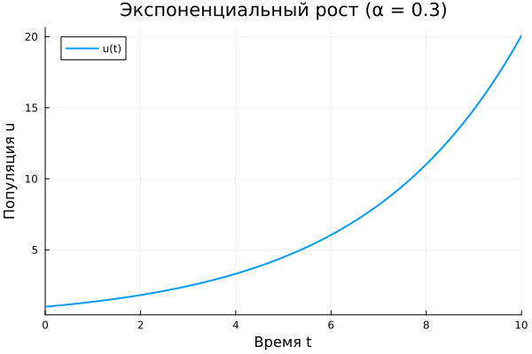
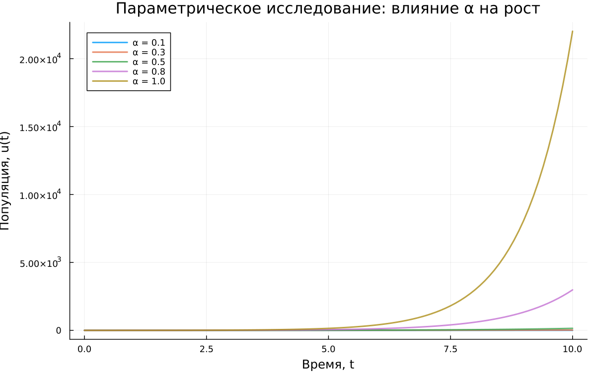
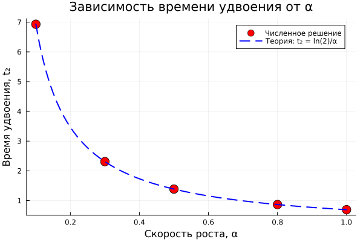
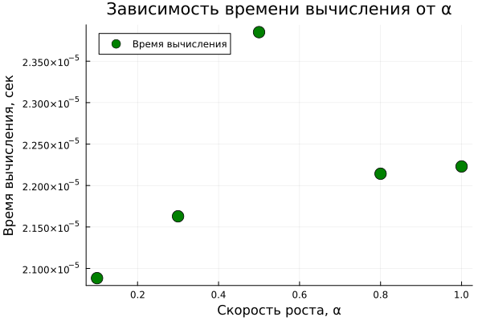

---
## Author
author:
  - name: Бахарев Дмитрий Александрович
    group: НКНбд-01-23
    email: traap.luuvv@mail.ru
    affiliation:
      - name: Российский университет дружбы народов
        country: Российская Федерация
        postal-code: 117198
        city: Москва
        address: ул. Миклухо-Маклая, д. 6
## Title
title: Лабораторная работа №1
subtitle: Подготовка стенда и модель экспоненциального роста
license: CC BY
date: today
date-format: "YYYY-MM-DD"
---

# Введение

## Актуальность

- Математическое моделирование — универсальный инструмент в естественных и технических науках.
- Модель экспоненциального роста — базовый пример динамической системы.
- Освоение современного инструментария (Julia, DrWatson, Literate, Quarto) необходимо для воспроизводимых исследований.

## Цель и задачи

**Цель:** освоить инструменты Julia/DrWatson/Literate/Quarto и исследовать модель экспоненциального роста.

**Задачи:**

1. Создать рабочее пространство курса.
2. Установить пакеты Julia.
3. Реализовать модель экспоненциального роста.
4. Провести параметрическое исследование.
5. Собрать отчёт в формате PDF/DOCX.

## Объект и предмет исследования

- **Объект:** дифференциальные уравнения первого порядка, описывающие динамику популяций.
- **Предмет:** численное решение модели экспоненциального роста в Julia.

# Теоретическая часть

## Модель экспоненциального роста

Уравнение:

$$\frac{du}{dt} = \alpha u, \quad u(0) = u_0.$$

Аналитическое решение:

$$u(t) = u_0 e^{\alpha t}.$$

Время удвоения:

$$T_2 = \frac{\ln 2}{\alpha}.$$

## Инструменты

| Инструмент | Назначение |
|---|---|
| Git + Gitflow | Контроль версий |
| Julia | Язык научных вычислений |
| DrWatson.jl | Организация проектов |
| Literate.jl | Литературное программирование |
| Quarto | Сборка отчётов PDF/DOCX |

# Методы и материалы

## Программное обеспечение

- ОС: Windows 11 + WSL (Ubuntu 22.04)
- Julia 1.13
- Пакеты: DrWatson, DifferentialEquations, Plots, DataFrames, Literate, IJulia, BenchmarkTools, Quarto
- Git + Gitflow

## Последовательность действий

1. Создан рабочий каталог курса на GitVerse.
2. Инициализирован Gitflow.
3. Создан проект DrWatson в `labs/lab01/project`.
4. Установлены пакеты Julia.
5. Написан скрипт `01_exponential_growth.jl` в Literate-стиле.
6. Сгенерированы `.qmd`, `.ipynb`, `.jl` через `tangle.jl`.
7. Собран отчёт в PDF и DOCX.

# Результаты

## Рабочий каталог

{width=60%}

## Проект DrWatson

{width=60%}

{width=60%}

## Численное решение

{width=70%}

## Код в Literate-стиле

{width=70%}

## Параметрическое исследование

Скрипт `02_exponential_growth.jl` решает задачу для набора $\alpha \in \{0.1, 0.3, 0.5, 0.8, 1.0\}$ и строит сравнительные графики.

{width=70%}

## Время удвоения vs α

{width=70%}

Численные точки совпадают с теоретической кривой.

## Бенчмаркинг

{width=70%}

## Jupyter-ноутбук с параметрами

{width=70%}

# Заключение

## Итоги

- Освоены Git, Gitflow, Julia, DrWatson, Literate.jl, Quarto.
- Реализована модель экспоненциального роста.
- Проведено параметрическое исследование.
- Численное решение совпадает с аналитическим.
- Отчёт собран в PDF и DOCX.

