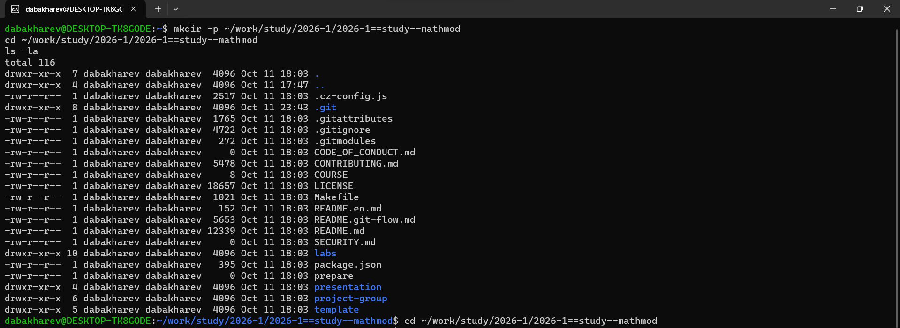
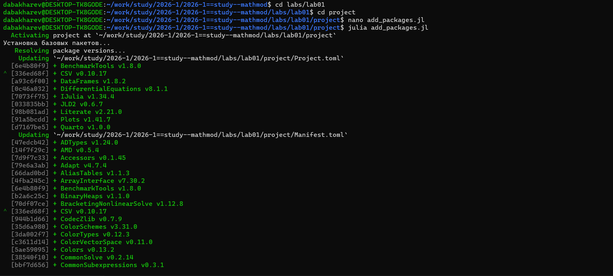
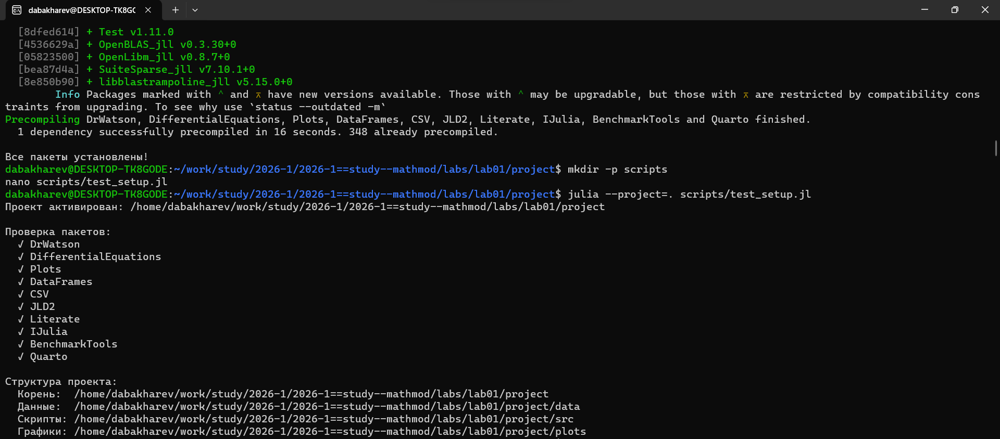
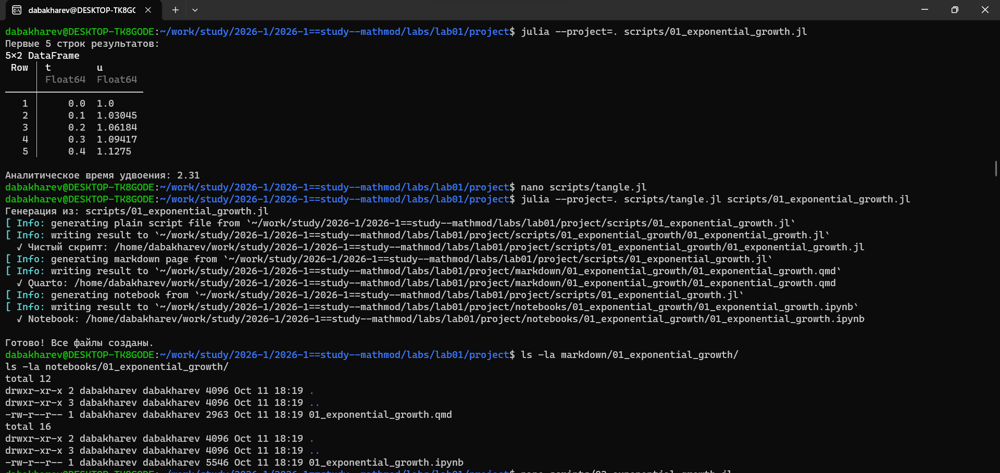
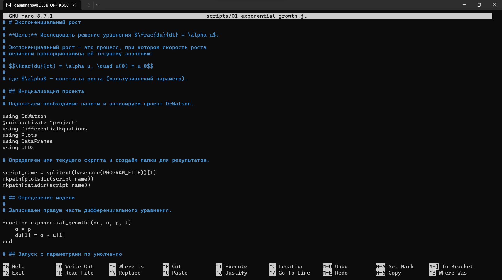
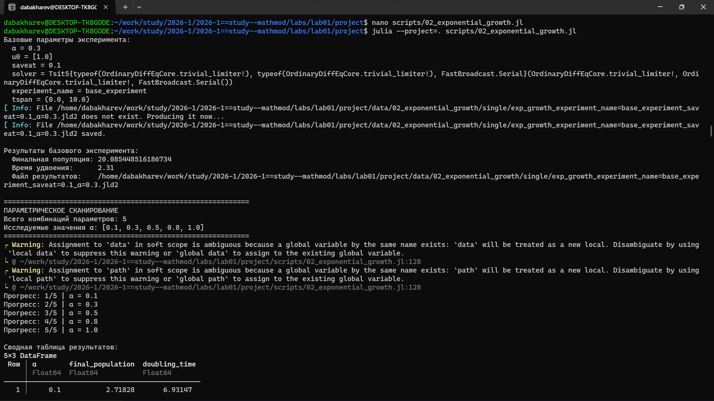
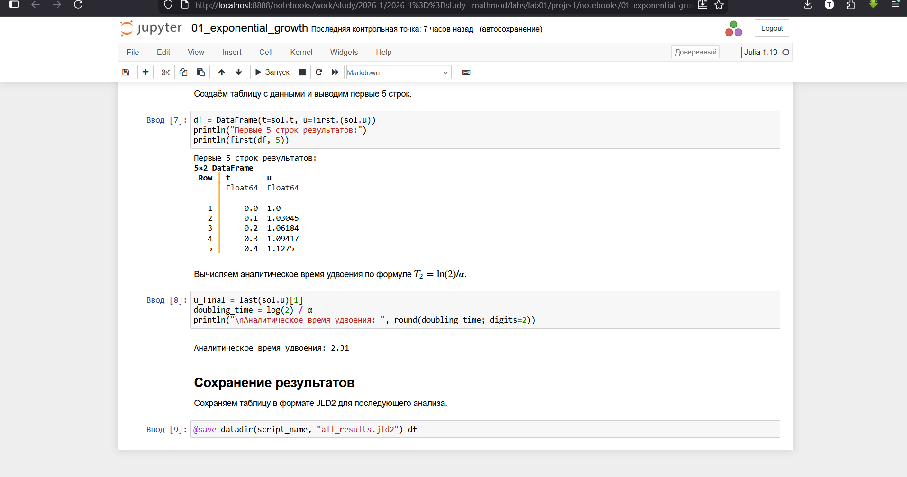
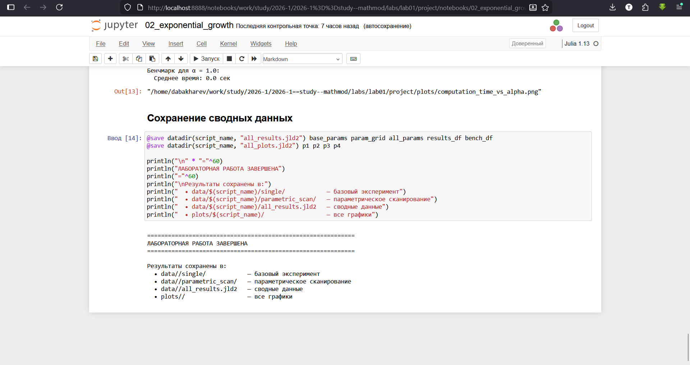

---
## Author
author:
  name: Дмитрий Александрович Бахарев
  group: НКНбд-01-23
  email: traap.luuvv@mail.ru
  affiliation:
    - name: Российский университет дружбы народов
      country: Российская Федерация
      postal-code: 117198
      city: Москва
      address: ул. Миклухо-Маклая, д. 6

## Title
title: "Отчёт по лабораторной работе №1"
subtitle: "Математическое моделирование"
license: "CC BY"
---

# Цель работы

Настройка рабочего пространства, знакомство с Julia

# Задание

— Создать рабочий каталог для всего курса.
— Создать рабочее пространство для программ в рамках лабораторной работы.
— Выполнить все задания по тексту лабораторной работы.
— Установить необходимые пакеты.
— Выполнить предложенный код.
— Преобразовать код в литературный стиль.
— Сгенерировать из литературного кода :
— чистый код;
— jupyter notebook;
— документацию в формате Quarto.
— Выполнить код из jupyter notebook.
— Интегрировать документацию в формате Quarto в отчёт.
— Добавить в код в литературном стиле вычисление для набора параметров.
— Сгенерировать из литературного кода с параметрами :
— чистый код;
— jupyter notebook;
— документацию в формате Quarto.
— Выполнить код из jupyter notebook с параметрами.
— Интегрировать документацию с параметрами в формате Quarto в отчёт.

# Теоретическое введение

Git — распределённая система управления версиями. Проект был создан Линусом Торвальдсом для управления разработкой ядра Linux, первая версия выпущена 7 апреля 2005 года; координатор — Дзюн Хамано. [@wiki:bash].

# Выполнение лабораторной работы

Рабочий каталог курса создан на основе шаблона (рис. @fig-workdir).

{#fig-workdir width=70%}

Проект DrWatson инициализирован в каталоге `labs/lab01/project` (рис. @fig-drwatson-setup).

{#fig-drwatson-setup width=70%}

Структура проекта DrWatson приведена на рис. @fig-project-structure.

{#fig-project-structure width=70%}

Базовый скрипт выполнен, результаты приведены на рис. @fig-first-run.

{#fig-first-run width=70%}

Скрипт переписан в стиле литературного программирования (рис. @fig-literate-style).

{#fig-literate-style width=70%}

Написан скрипт параметрического исследования, из него сгенерированы производные форматы (рис. @fig-param-script).

{#fig-param-script width=70%}

Jupyter-ноутбук с параметрами выполнен (рис. @fig-jupyter-param).

{#fig-jupyter-param width=70%}

<<< добавлено мной >>>
Графики параметрического исследования, полученные в ноутбуке, приведены на рис. @fig-jupyter-param-graphs.

{#fig-jupyter-param-graphs width=70%}

Экспоненциальный рост



Параметрическое исследование



# Заключение

В ходе лабораторной работы были освоены :

- система контроля версий Git и модель ветвления Gitflow;
- инструменты Julia, DrWatson, Literate.jl;
- система публикации Quarto для сборки отчётов;
- численные методы решения ОДУ на примере модели экспоненциального роста.

Проведено параметрическое исследование, подтверждено соответствие численного и аналитического решений.

# Список литературы {.unnumbered}

::: {#refs}
:::

