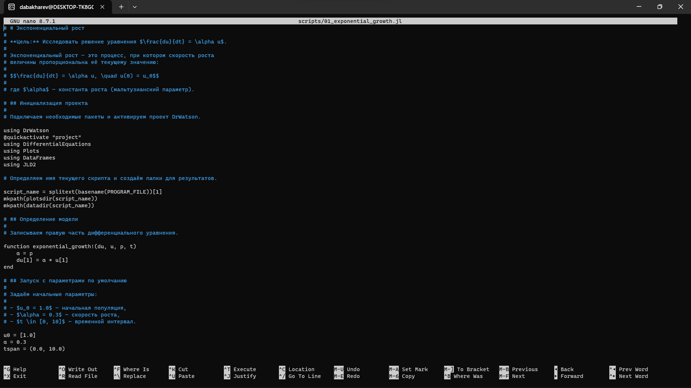
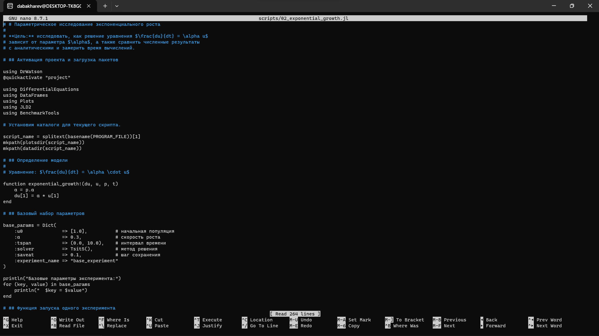

---
## Author
author:
  name: Дмитрий Александрович Бахарев
  group: НКНбд-01-23
  email: traap.luuvv@mail.ru
  affiliation:
    - name: Российский университет дружбы народов
      country: Российская Федерация
      postal-code: 117198
      city: Москва
      address: ул. Миклухо-Маклая, д. 6

## Title
title: "Отчёт по лабораторной работе №1"
subtitle: "Математическое моделирование"
license: "CC BY"
---

# Цель работы

Настройка рабочего пространства, знакомство с Julia

# Задание

— Создать рабочий каталог для всего курса.
— Создать рабочее пространство для программ в рамках лабораторной работы.
— Выполнить все задания по тексту лабораторной работы.
— Установить необходимые пакеты.
— Выполнить предложенный код.
— Преобразовать код в литературный стиль.
— Сгенерировать из литературного кода :
— чистый код;
— jupyter notebook;
— документацию в формате Quarto.
— Выполнить код из jupyter notebook.
— Интегрировать документацию в формате Quarto в отчёт.
— Добавить в код в литературном стиле вычисление для набора параметров.
— Сгенерировать из литературного кода с параметрами :
— чистый код;
— jupyter notebook;
— документацию в формате Quarto.
— Выполнить код из jupyter notebook с параметрами.
— Интегрировать документацию с параметрами в формате Quarto в отчёт.

# Теоретическое введение

Git — распределённая система управления версиями. Проект был создан Линусом Торвальдсом для управления разработкой ядра Linux, первая версия выпущена 7 апреля 2005 года; координатор — Дзюн Хамано. [@wiki:bash].

# Выполнение лабораторной работы

# Выполнение лабораторной работы

## Создание рабочего пространства

Рабочий каталог курса создан на основе шаблона (рис. @fig-1).

{#fig-1 width=70%}

Проект DrWatson инициализирован в каталоге `labs/lab01/project`
(рис. @fig-2).

{#fig-2 width=70%}

Структура проекта DrWatson приведена на рис. @fig-3.

{#fig-3 width=70%}

## Установка пакетов

Пакеты Julia успешно установлены (рис. @fig-4).

{#fig-4 width=70%}

Проверка загрузки пакетов показана на рис. @fig-5.

{#fig-5 width=70%}

## Код скриптов

Скрипт `01_exponential_growth.jl` написан в стиле литературного
программирования — содержит Markdown-комментарии и код на Julia
(рис. @fig-9).

{#fig-9 width=70%}

Скрипт `02_exponential_growth.jl` реализует параметрическое исследование
модели (рис. @fig-10).

{#fig-10 width=70%}

## Запуск базового скрипта

Базовый скрипт выполнен, результаты приведены на рис. @fig-6.

{#fig-6 width=70%}

## Параметрическое исследование

Скрипт `02_exponential_growth.jl` решает задачу для набора значений
$\alpha \in \{0.1, 0.3, 0.5, 0.8, 1.0\}$ и строит сравнительные графики
(рис. @fig-7).

{#fig-7 width=70%}

## Jupyter-ноутбук с параметрами

Jupyter-ноутбук с параметрическим исследованием выполнен (рис. @fig-8).

{#fig-8 width=70%}

## Листинги из Julia





# Заключение

В ходе лабораторной работы были освоены :

- система контроля версий Git и модель ветвления Gitflow;
- инструменты Julia, DrWatson, Literate.jl;
- система публикации Quarto для сборки отчётов;
- численные методы решения ОДУ на примере модели экспоненциального роста.

Проведено параметрическое исследование, подтверждено соответствие численного и аналитического решений.

# Список литературы {.unnumbered}

::: {#refs}
:::

