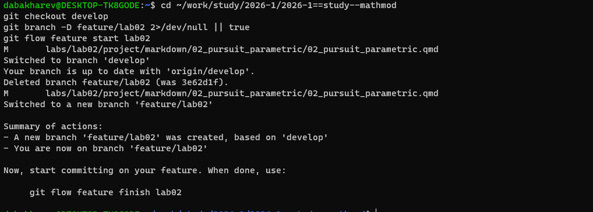
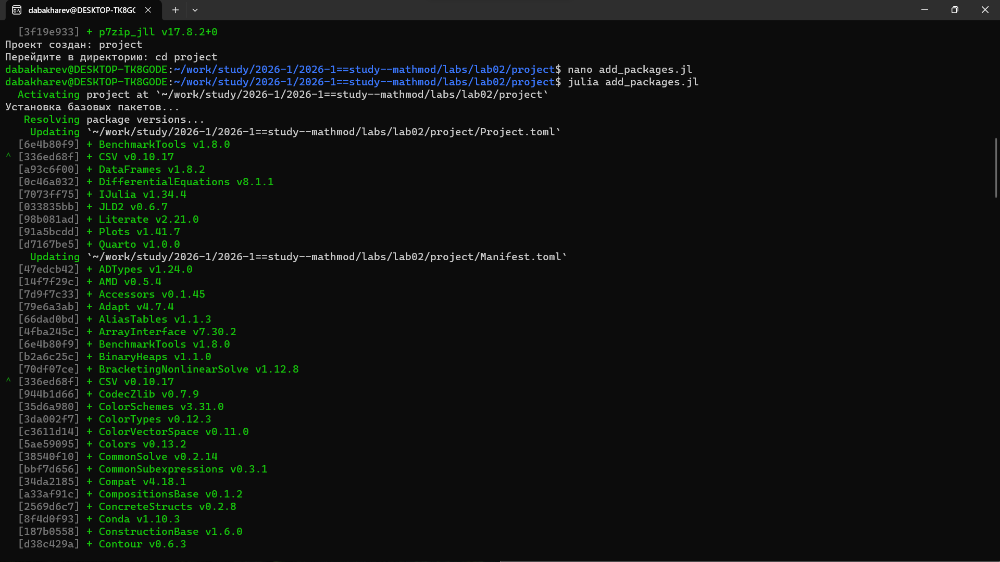
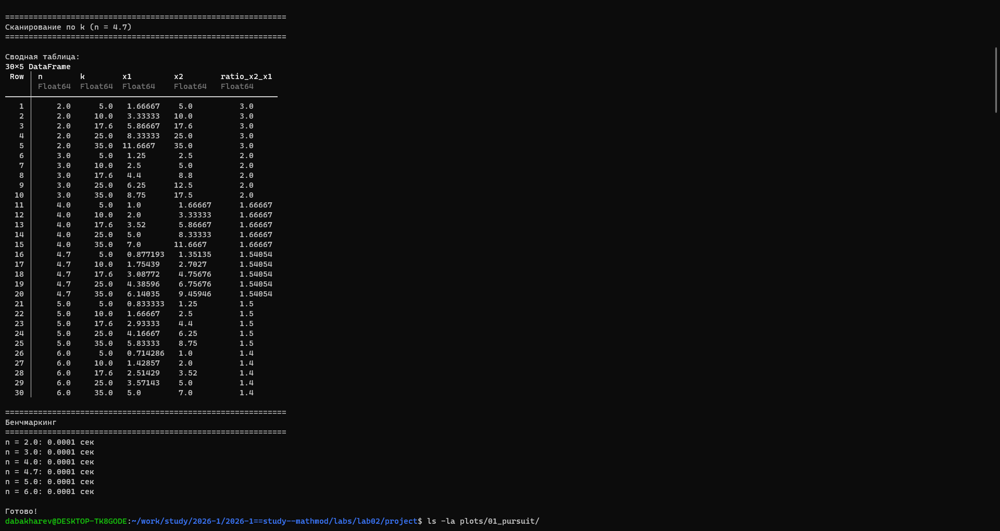
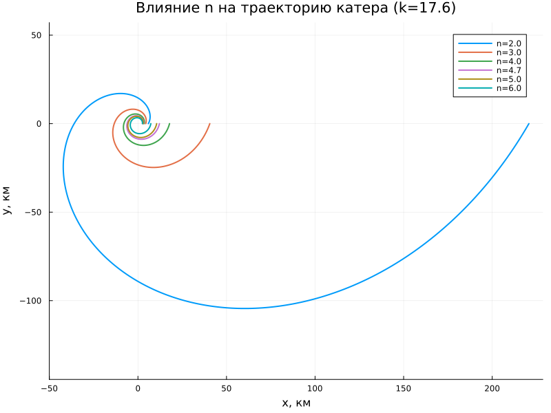
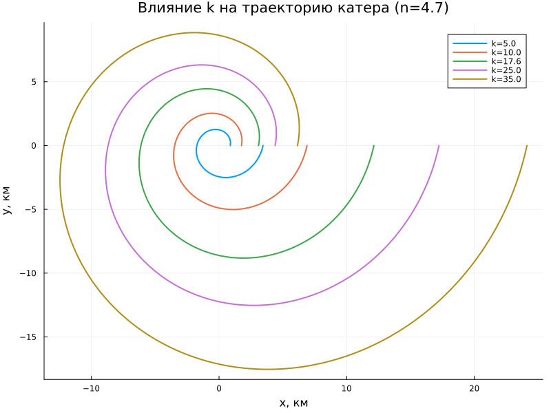
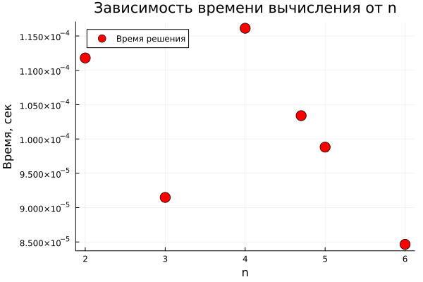
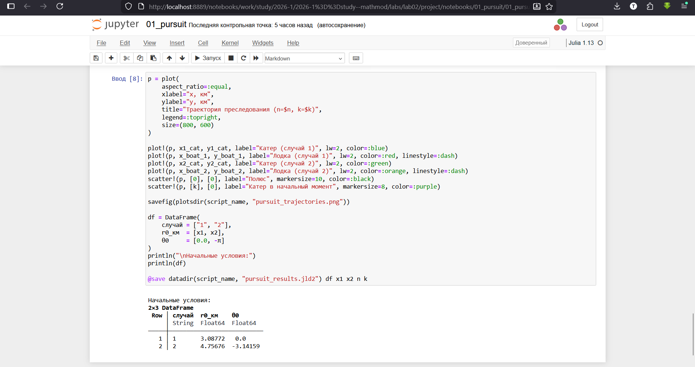
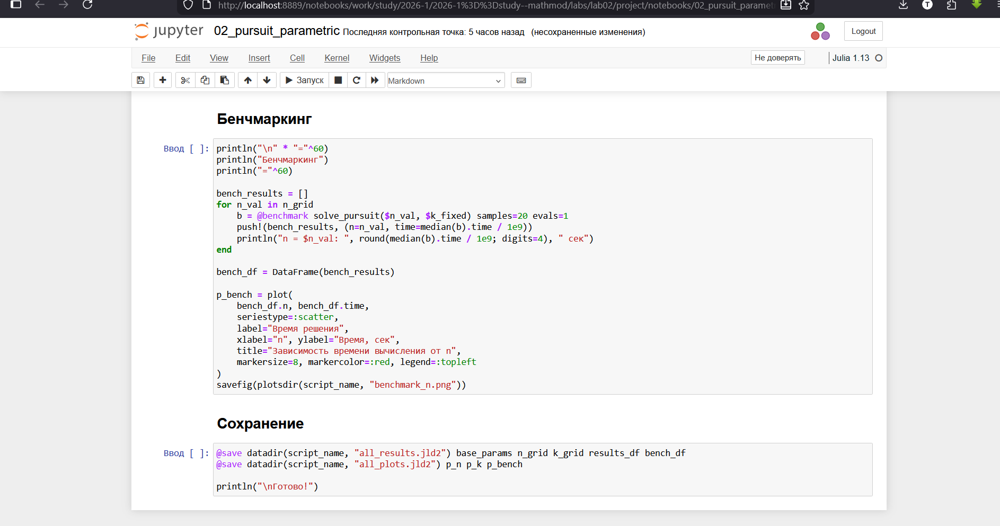

---
## Author
author:
  - name: Бахарев Дмитрий Александрович
    group: НКНбд-01-23
    email: traap.luuvv@mail.ru
    affiliation:
      - name: Российский университет дружбы народов
        country: Российская Федерация
        postal-code: 117198
        city: Москва
        address: ул. Миклухо-Маклая, д. 6
## Title
title: Лабораторная работа №2
subtitle: Задача преследования браконьеров
license: CC BY
---

# Введение

## Актуальность

- Задача преследования подвижного объекта — классическая задача теории управления.
- Применяется в системах ПРО, морском преследовании, автономной навигации.
- Требуется построить траекторию преследователя, при которой он догонит цель.

## Цель и задачи

**Цель:** построить математическую модель для выбора правильной стратегии
при решении задачи о погоне.

**Задачи:**

1. Записать уравнение движения катера с начальными условиями.
2. Построить траектории движения катера и лодки для двух случаев.
3. Найти точки пересечения траекторий.

# Теоретическая часть

## Постановка задачи

На море в тумане катер береговой охраны преследует лодку браконьеров.
Лодка обнаружена на расстоянии $k = 17.6$ км от катера. Скорость катера
в $n = 4.7$ раза больше скорости лодки.

Введём полярные координаты $(r, \theta)$:
- Полюс — точка обнаружения лодки.
- Полярная ось $r$ — направление на катер.

## Математическая модель

Уравнение движения катера в полярных координатах:

$$\frac{dr}{d\theta} = \frac{r}{\sqrt{n^2 - 1}}.$$

Для $n = 4.7$:

$$\frac{dr}{d\theta} = \frac{r}{\sqrt{21.09}}.$$

Аналитическое решение:

$$r(\theta) = C e^{\theta / \sqrt{21.09}}.$$

## Два случая

**Случай 1.** Катер и лодка сближаются:

$$x_1 = \frac{k}{n+1} = \frac{17.6}{5.7} \approx 3.088 \text{ км}, \quad \theta_0 = 0.$$

**Случай 2.** Катер и лодка удаляются:

$$x_2 = \frac{k}{n-1} = \frac{17.6}{3.7} \approx 4.757 \text{ км}, \quad \theta_0 = -\pi.$$

Аналитические решения:

$$r_1 = \frac{17.6}{5.7} e^{\theta / \sqrt{21.09}}, \quad r_2 = \frac{17.6}{3.7} e^{(\theta + \pi) / \sqrt{21.09}}.$$

# Реализация

## Создание проекта DrWatson

{width=60%}

## Установка пакетов

{width=60%}

## Запуск базового скрипта

{width=60%}

Получены начальные условия: $x_1 = 3.088$ км, $x_2 = 4.757$ км.

## Траектории катера и лодки

{width=70%}

# Результаты

## Параметрическое исследование

{width=70%}

Из таблицы видно, что отношение $x_2 / x_1 = (n+1)/(n-1)$ не зависит
от $k$ и определяется только $n$.

## Влияние параметра n

{width=70%}

## Влияние параметра k

{width=70%}

## Бенчмаркинг

{width=70%}

Время решения мало ($\sim 10^{-4}$ с) для всех значений $n$.

# Jupyter-ноутбуки

## Ноутбук базового скрипта

{width=70%}

## Ноутбук с параметрами

{width=70%}

# Заключение

## Итоги

- Освоена постановка задачи преследования браконьеров.
- Реализована численная модель в Julia с использованием DrWatson и Literate.jl.
- Проведено параметрическое исследование по параметрам n и k.
- Найдены точки пересечения траекторий катера и лодки.
- Отчёт собран в PDF и DOCX, презентация — в PDF/HTML/Markdown.

