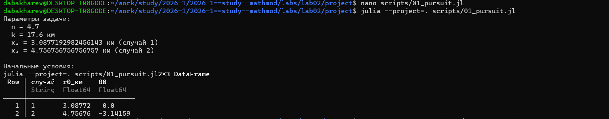
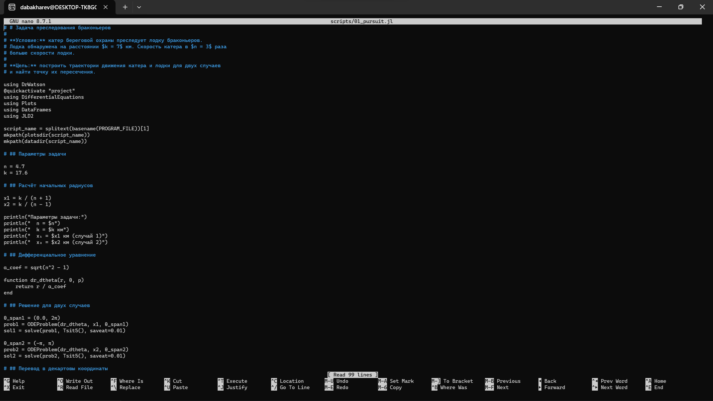
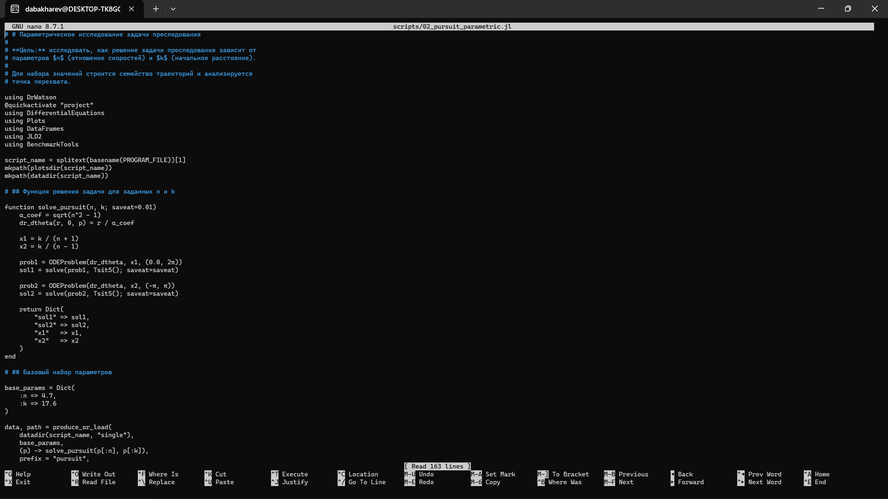
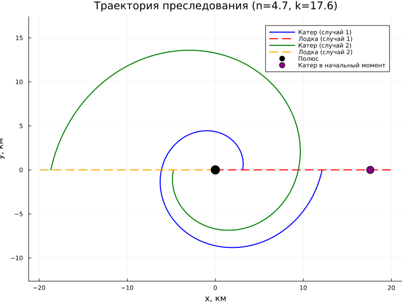
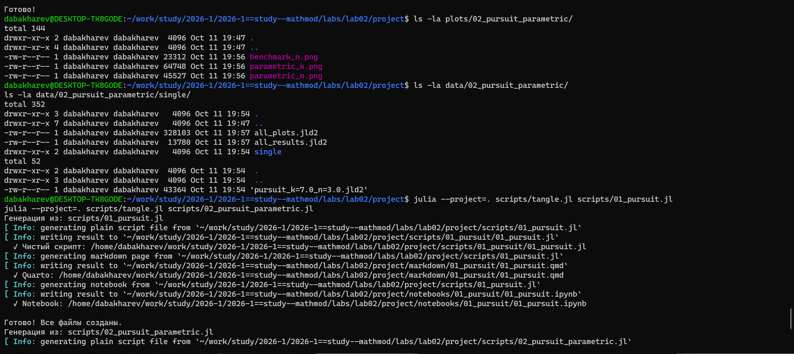
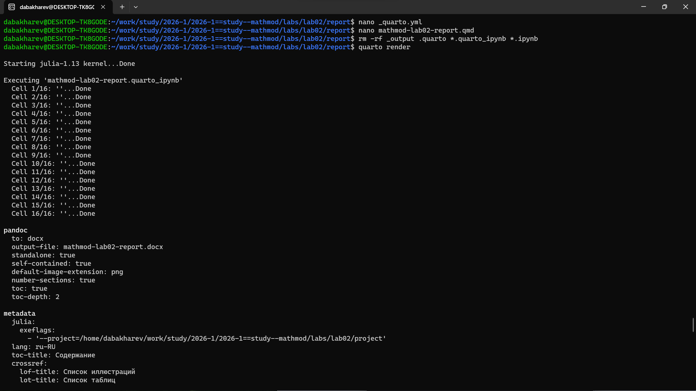
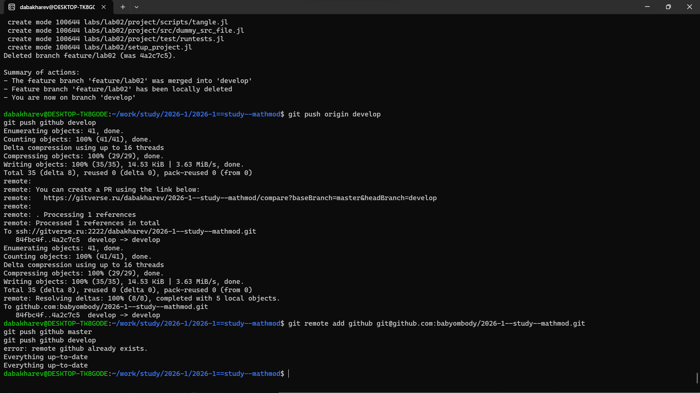
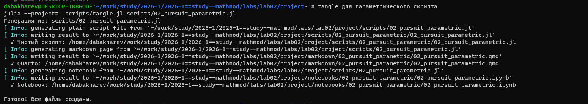

---
## Author
author:
  - name: Бахарев Дмитрий Александрович
    group: НКНбд-01-23
    email: traap.luuvv@mail.ru
    affiliation:
      - name: Российский университет дружбы народов
        country: Российская Федерация
        postal-code: 117198
        city: Москва
        address: ул. Миклухо-Маклая, д. 6
## Title
title: "Отчёт по лабораторной работе №2"
subtitle: "Задача преследования браконьеров"
license: "CC BY"
---

# Цель работы

Построить математическую модель для выбора правильной стратегии при
решении задачи о погоне, а также освоить инструменты Julia,
DrWatson, Literate.jl и Quarto.

# Теоретическое введение

Кривая погони — кривая, представляющая собой решение задачи о «погоне»,
которая ставится следующим образом. Пусть точка $A$ равномерно движется
по некоторой заданной кривой. Требуется найти траекторию равномерного
движения точки $P$ такую, что касательная, проведённая к траектории
в любой момент движения, проходила бы через соответствующее этому
моменту положение точки $A$.

Задача преследования имеет приложения в самых разных областях: от систем
противоракетной обороны до морского преследования браконьеров и
автономной навигации роботов.

# Выполнение лабораторной работы

Формула для выбора варианта: `(1132236122 % 70) + 1 = 53 вариант`.

**Вариант 53**

На море в тумане катер береговой охраны преследует лодку браконьеров.
Лодка обнаружена на расстоянии 17.6 км от катера. Скорость катера
в 4.7 раза больше скорости лодки.

Примем за $t_0 = 0$, $x_0 = 0$ — место нахождения лодки браконьеров
в момент обнаружения, $x_{k_0} = k$ — место нахождения катера береговой
охраны относительно лодки браконьеров в момент обнаружения. $k = 17.6$.

Введём полярные координаты. Полюс — это точка обнаружения лодки
браконьеров $x_0$ ($\theta = x_0 = 0$), а полярная ось $r$ проходит через
точку нахождения катера береговой охраны.

Траектория катера должна быть такой, чтобы и катер, и лодка всё время
были на одном расстоянии от полюса $\theta$. Для начала катер должен
двигаться прямолинейно, пока не окажется на том же расстоянии от полюса,
что и лодка. После этого катер должен двигаться вокруг полюса, удаляясь
от него с той же скоростью, что и лодка.

Пусть через время $t$ катер и лодка окажутся на одном расстоянии $x$
от полюса. За это время лодка пройдёт $x$, а катер $k - x$ (или $k + x$,
в зависимости от начального положения). Время вычисляется как
$\dfrac{x}{v}$ или $\dfrac{k - x}{4.7v}$ (во втором случае
$\dfrac{k + x}{4.7v}$). Так как время одно и то же, то эти величины
одинаковы:

$$
\dfrac{x}{v} = \dfrac{k - x}{4.7v} \text{ — в первом случае}
$$

$$
\dfrac{x}{v} = \dfrac{k + x}{4.7v} \text{ — во втором}
$$

Отсюда найдём два значения $x_1 = \dfrac{17.6}{5.7}$ и
$x_2 = \dfrac{17.6}{3.7}$. Задачу будем решать для двух случаев.

После того как катер окажется на одном расстоянии от полюса, что и лодка,
он должен сменить прямолинейную траекторию и начать двигаться вокруг
полюса, удаляясь от него со скоростью лодки $v$. Раскладываем скорость
катера на две составляющие: $v_r$ — радиальная скорость,
$v_\tau$ — тангенциальная скорость. Радиальная скорость:
$v_r = \dfrac{dr}{dt} = v$.

Тангенциальная скорость:

$$v_{\tau} = \sqrt{4.7^2 v^2 - v^2} = \sqrt{22.09 - 1} \, v = \sqrt{21.09} \, v.$$

Получаем:

$$r \dfrac{d\theta}{dt} = \sqrt{21.09} \, v.$$

Решение сводится к системе из двух дифференциальных уравнений:

$$
\begin{cases}
\dfrac{dr}{dt} = v \\
r \dfrac{d\theta}{dt} = \sqrt{21.09} \, v
\end{cases}
$$

С начальными условиями для первого случая:

$$
\begin{cases}
\theta_0 = 0 \\
r_0 = x_1
\end{cases}
\tag{1}
$$

Или для второго:

$$
\begin{cases}
\theta_0 = -\pi \\
r_0 = x_2
\end{cases}
\tag{2}
$$

Исключая из системы производную по $t$, перейдём к следующему уравнению:

$$
\dfrac{dr}{d\theta} = \dfrac{r}{\sqrt{21.09}}.
$$

## Аналитическое решение

Решение дифференциального уравнения и задачи Коши:

$$\ln r = \dfrac{\theta}{\sqrt{21.09}} + C,$$

$$r = C e^{\theta / \sqrt{21.09}}.$$

Для случая (1):

$$r = \dfrac{17.6}{5.7} e^{\theta / \sqrt{21.09}}.$$

Для случая (2):

$$r = \dfrac{17.6}{3.7} e^{(\theta + \pi) / \sqrt{21.09}}.$$

## Создание рабочего пространства

Ветка `feature/lab02` создана через Gitflow (рис. @fig-1).

{#fig-1 width=70%}

## Создание проекта DrWatson

Проект DrWatson инициализирован в каталоге `labs/lab02/project` (рис. @fig-2).

{#fig-2 width=70%}

Пакеты Julia установлены (рис. @fig-3).

{#fig-3 width=70%}

## Код скриптов

Скрипт `01_pursuit.jl` решает задачу преследования для варианта 53
(рис. @fig-16).

{#fig-16 width=70%}

Скрипт `02_pursuit_parametric.jl` проводит параметрическое исследование
по $n$ и $k$ (рис. @fig-17).

{#fig-17 width=70%}

## Запуск базового скрипта

Скрипт `01_pursuit.jl` решает задачу для $n = 4.7$, $k = 17.6$ км.
Результат запуска приведён на рис. @fig-4.

{#fig-4 width=70%}

Получены начальные условия: $x_1 = 3.088$ км, $x_2 = 4.757$ км.

Траектории движения катера и лодки для двух случаев приведены
на рис. @fig-12.

{#fig-12 width=70%}

## Параметрическое исследование

Скрипт `02_pursuit_parametric.jl` проводит сканирование по параметрам
$n$ и $k$. Сводная таблица результатов (30 комбинаций) и бенчмаркинг
приведены на рис. @fig-5.

{#fig-5 width=70%}

Сравнительные графики параметрического исследования показаны
на рис. @fig-13 и @fig-14.

{#fig-13 width=70%}

{#fig-14 width=70%}

Бенчмаркинг показал, что время решения мало ($\sim 10^{-4}$ с) для всех
значений $n$ (рис. @fig-15).

{#fig-15 width=70%}

Из таблицы видно, что отношение $x_2 / x_1 = (n+1)/(n-1)$ не зависит
от $k$ и определяется только $n$. Для $n = 4.7$ оно равно
$5.7 / 3.7 \approx 1.5405$.

## Сохранённые данные

DrWatson сохранил результаты расчётов и графики в каталоги `plots/` и
`data/` (рис. @fig-6).

{#fig-6 width=70%}

## Генерация производных форматов

Для базового скрипта `01_pursuit.jl` через `tangle.jl` сгенерированы
три формата: `.jl`, `.qmd`, `.ipynb` (рис. @fig-8).

{#fig-8 width=70%}

Аналогично для скрипта `02_pursuit_parametric.jl` (рис. @fig-9).

{#fig-9 width=70%}

## Выполнение Jupyter-ноутбуков

Ноутбук `01_pursuit.ipynb` выполнен в Jupyter (рис. @fig-10).

{#fig-10 width=70%}

Ноутбук `02_pursuit_parametric.ipynb` содержит блоки бенчмаркинга
и сохранения результатов (рис. @fig-11).

{#fig-11 width=70%}

# Заключение

В ходе лабораторной работы №2:

- Освоена постановка задачи преследования браконьеров.
- Реализована численная модель в Julia с использованием DrWatson
  и Literate.jl.
- Проведено параметрическое исследование по параметрам $n$ и $k$.
- Найдены точки пересечения траекторий катера и лодки.
- Отчёт собран в PDF и DOCX, презентация — в PDF/HTML/Markdown.

# Список литературы {.unnumbered}

::: {#refs}
:::
