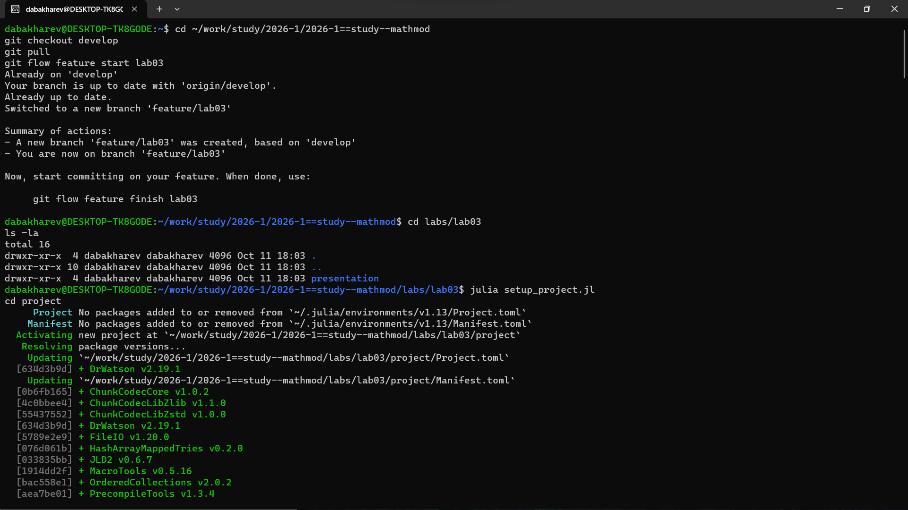
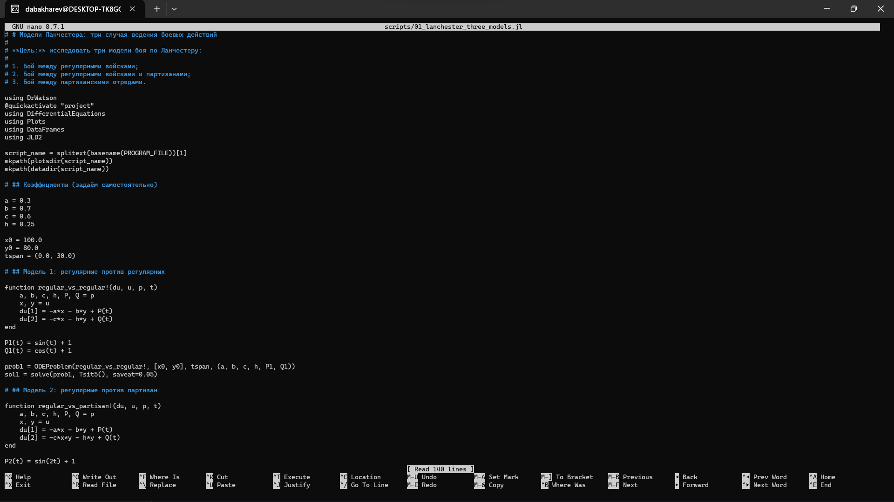
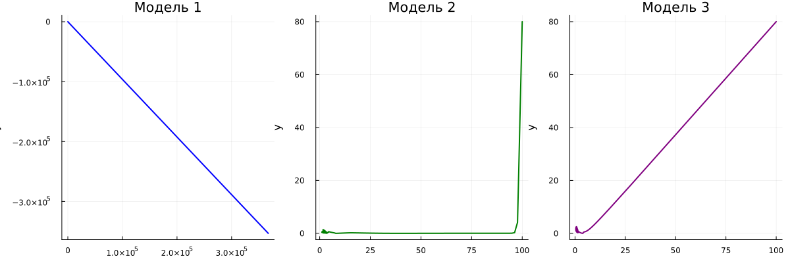
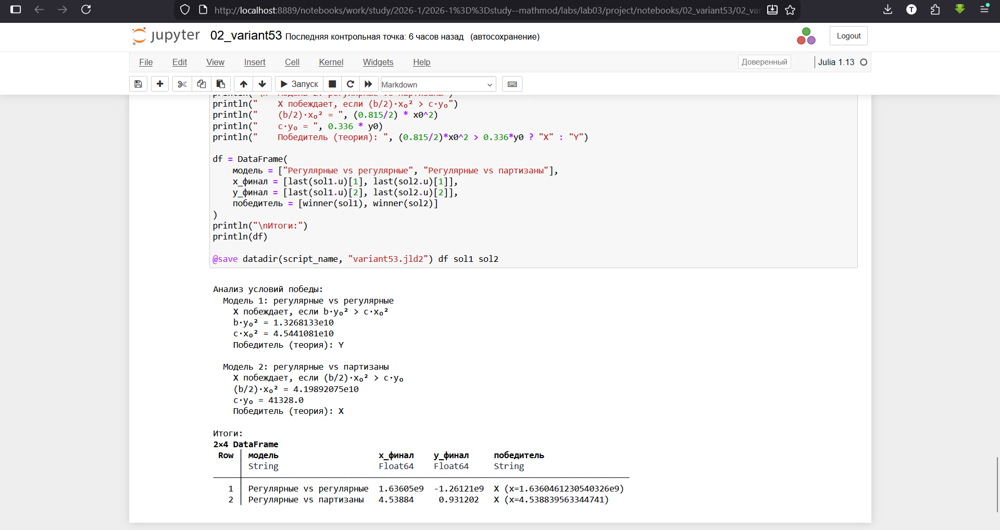
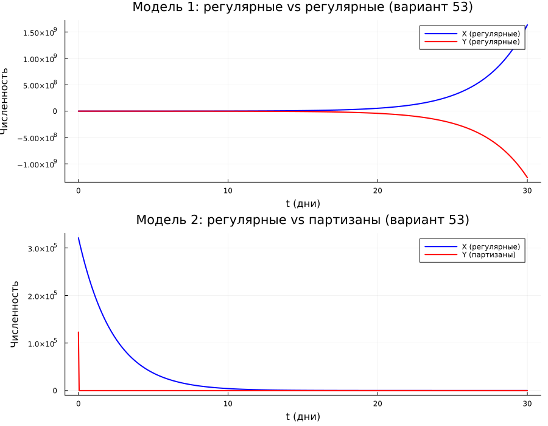
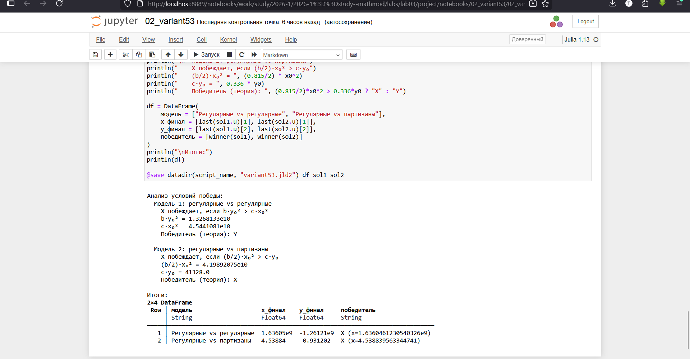

---
## Author
author:
  - name: Бахарев Дмитрий Александрович
    group: НКНбд-01-23
    email: traap.luuvv@mail.ru
    affiliation:
      - name: Российский университет дружбы народов
        country: Российская Федерация
        postal-code: 117198
        city: Москва
        address: ул. Миклухо-Маклая, д. 6
## Title
title: Лабораторная работа №3
subtitle: Модели Ланчестера
license: CC BY
---

# Введение

## Актуальность

- Модели Ланчестера — классические модели боевых действий.
- Применяются в военном деле, теории игр, экономике, эпидемиологии.
- Позволяют оценить исход противостояния до его начала.

## Цель и задачи

**Цель:** исследовать три модели ведения боевых действий по
Ланчестеру и освоить их численную реализацию в Julia.

**Задачи:**

1. Изучить три модели: регулярные vs регулярные, регулярные vs
   партизаны, партизаны vs партизаны.
2. Реализовать численное решение в Julia.
3. Определить победителя в каждой модели.
4. Решить задачу для варианта 53.

# Теоретическая часть

## Модель 1: регулярные vs регулярные

$$
\begin{cases}
\dfrac{dx}{dt} = -a x - b y + P(t), \\[6pt]
\dfrac{dy}{dt} = -c x - h y + Q(t).
\end{cases}
$$

$a$, $h$ — потери, не связанные с боем; $b$, $c$ — эффективность
боевых действий; $P(t)$, $Q(t)$ — подкрепление.

## Модель 2: регулярные vs партизаны

$$
\begin{cases}
\dfrac{dx}{dt} = -a x - b y + P(t), \\[6pt]
\dfrac{dy}{dt} = -c x y - h y + Q(t).
\end{cases}
$$

Партизаны менее уязвимы: потери пропорциональны как численности
регулярных войск, так и численности самих партизан.

## Модель 3: партизаны vs партизаны

$$
\begin{cases}
\dfrac{dx}{dt} = -a x - b x y + P(t), \\[6pt]
\dfrac{dy}{dt} = -h y - c x y + Q(t).
\end{cases}
$$

## Простейшая модель

Без подкрепления и потерь, не связанных с боем:

$$
\begin{cases}
\dfrac{dx}{dt} = -b y, \\[6pt]
\dfrac{dy}{dt} = -c x.
\end{cases}
$$

Точное решение: $c x^2 - b y^2 = C$.

**Вывод:** для борьбы с вдвое более многочисленным противником нужно
вчетверо более мощное оружие, с втрое — в девять раз.

# Реализация

## Создание проекта DrWatson

{width=60%}

## Установка пакетов

{width=60%}

## Код скриптов

Скрипт `01_lanchester_three_models.jl` реализует три модели Ланчестера
(рис. 1).

{width=70%}

Скрипт `02_variant53.jl` решает задачу для варианта 53 (рис. 2).

{width=70%}

# Результаты: задание 1

## Победители в трёх моделях

| Модель | Победитель |
|---|---|
| Регулярные vs регулярные | X |
| Регулярные vs партизаны | X |
| Партизаны vs партизаны | Y |

## Траектории численностей

{width=70%}

## Фазовые портреты

{width=70%}

## Jupyter-ноутбук задания 1

{width=70%}

# Результаты: вариант 53

## Условие варианта 53

- $x_0 = 321000$, $y_0 = 123000$
- Модель 1: регулярные vs регулярные
- Модель 2: регулярные vs партизаны

## Результаты расчёта

{width=70%}

**Модель 1:** теория — победа Y
($1.33 \times 10^{10} < 4.54 \times 10^{10}$),
но численно X уходит в большие значения — модель без подкрепления
неограниченно растёт.

**Модель 2:** победа X (регулярные), теория и численный расчёт
согласуются ($4.20 \times 10^{10} > 4.13 \times 10^{4}$).

## Графики варианта 53

{width=70%}

## Jupyter-ноутбук варианта 53

{width=70%}

# Заключение

## Итоги

- Изучены три модели боевых действий по Ланчестеру.
- Реализованы численные решения в Julia.
- Определены победители в каждой модели.
- Проведён анализ условий победы для варианта 53.
- Отчёт собран в PDF и DOCX.

