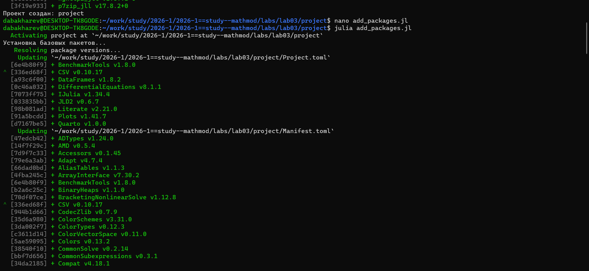
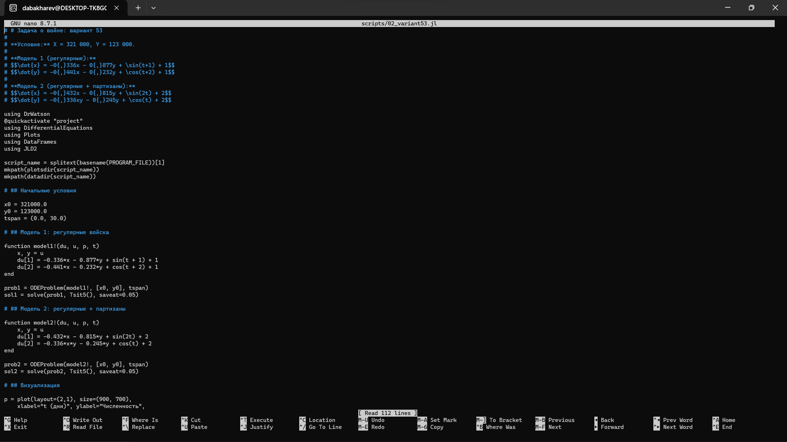
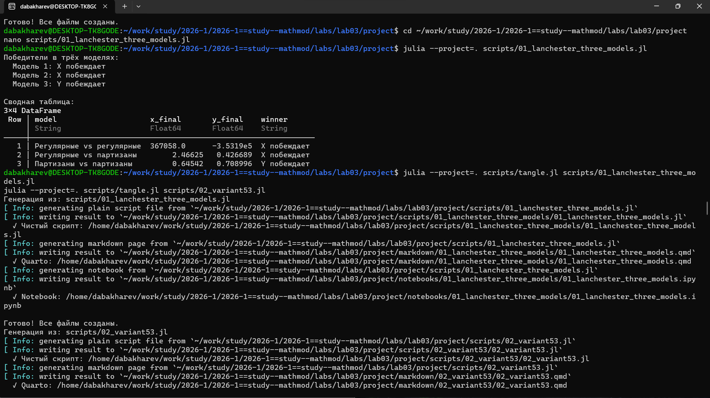
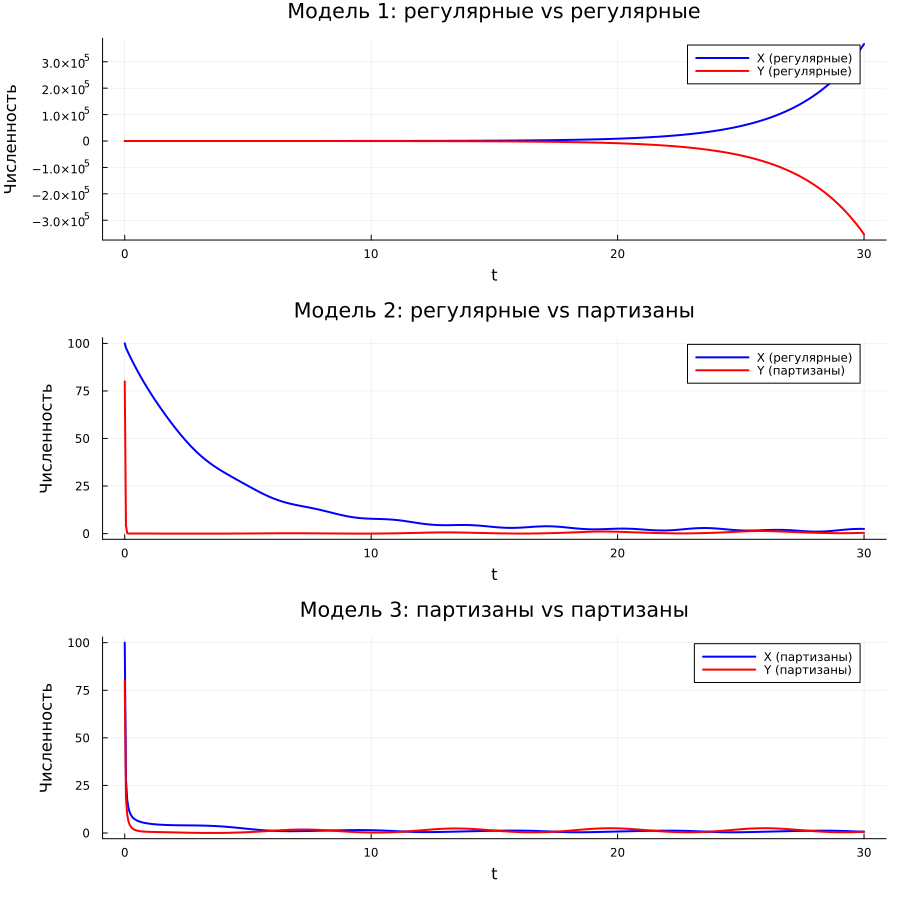
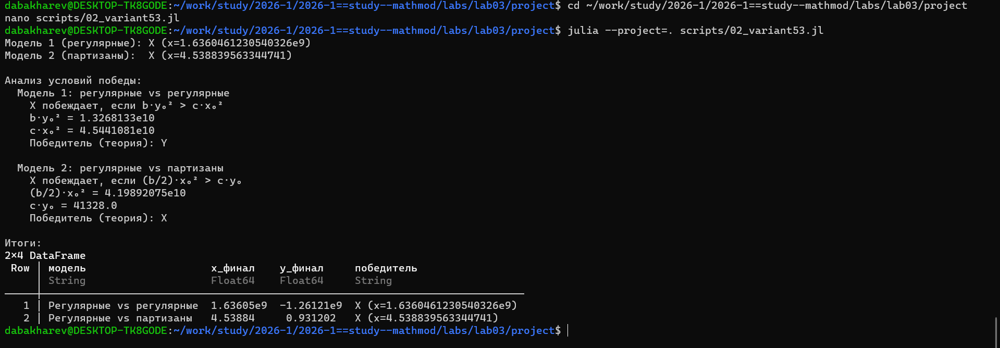
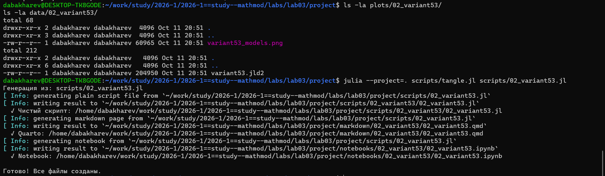

---
## Author
author:
  - name: Бахарев Дмитрий Александрович
    group: НКНбд-01-23
    email: traap.luuvv@mail.ru
    affiliation:
      - name: Российский университет дружбы народов
        country: Российская Федерация
        postal-code: 117198
        city: Москва
        address: ул. Миклухо-Маклая, д. 6
## Title
title: "Отчёт по лабораторной работе №3"
subtitle: "Модели Ланчестера"
license: "CC BY"
---

# Цель работы

Исследовать три модели ведения боевых действий по Ланчестеру,
освоить их численную реализацию в Julia и провести сравнительный анализ.

# Задание

1. Провести рассуждения и вывод дифференциальных уравнений для трёх
   моделей Ланчестера:
   - между регулярными войсками;
   - между регулярными войсками и партизанами;
   - между партизанскими отрядами.
2. Построить траектории изменения численностей для двух случаев
   (вариант 53).
3. Определить победителя и условия победы для каждой модели.

# Теоретическое введение

Модели Ланчестера описывают динамику боевых действий между двумя
противоборствующими сторонами. Характеристикой соперников являются
численности сторон $x(t)$ и $y(t)$. Если одна из численностей обращается
в нуль — сторона считается проигравшей.

## Модель 1: регулярные vs регулярные

$$
\begin{cases}
\dfrac{dx}{dt} = -a x(t) - b y(t) + P(t), \\[6pt]
\dfrac{dy}{dt} = -c x(t) - h y(t) + Q(t).
\end{cases}
$$

Здесь $a$ и $h$ — потери, не связанные с боевыми действиями;
$b$ и $c$ — эффективность боевых действий сторон $Y$ и $X$
соответственно; $P(t)$ и $Q(t)$ — подкрепление.

## Модель 2: регулярные vs партизаны

$$
\begin{cases}
\dfrac{dx}{dt} = -a x(t) - b y(t) + P(t), \\[6pt]
\dfrac{dy}{dt} = -c x(t) y(t) - h y(t) + Q(t).
\end{cases}
$$

Нерегулярные войска менее уязвимы, поэтому темп потерь партизан
пропорционален как численности регулярных войск, так и численности
самих партизан.

## Модель 3: партизаны vs партизаны

$$
\begin{cases}
\dfrac{dx}{dt} = -a x(t) - b x(t) y(t) + P(t), \\[6pt]
\dfrac{dy}{dt}
= -h y(t) - c x(t) y(t) + Q(t).
\end{cases}
$$

## Простейшая модель

В простейшей модели борьбы двух противников (без подкрепления и потерь,
не связанных с боем) система принимает вид:

$$
\begin{cases}
\dfrac{dx}{dt} = -b y(t), \\[6pt]
\dfrac{dy}{dt} = -c x(t).
\end{cases}
$$

Эта модель допускает точное решение: $c x^2 - b y^2 = C$.

Вывод: для борьбы с вдвое более многочисленным противником нужно
в четыре раза более мощное оружие, с втрое более многочисленным — в девять
раз и так далее.

# Выполнение лабораторной работы

## Задание 1: три модели Ланчестера

### Создание рабочего пространства

Ветка `feature/lab03` создана через Gitflow, затем инициализирован
проект DrWatson в каталоге `labs/lab03/project` (рис. @fig-1).

{#fig-1 width=70%}

### Установка пакетов

Пакеты Julia установлены в проект (рис. @fig-2).

{#fig-2 width=70%}

## Код скриптов

Скрипт `01_lanchester_three_models.jl` реализует три модели боевых
действий (рис. @fig-13).

{#fig-13 width=70%}

Скрипт `02_variant53.jl` решает задачу для варианта 53 (рис. @fig-14).

{#fig-14 width=70%}

### Результаты трёх моделей

Скрипт `01_lanchester_three_models.jl` моделирует три случая боевых
действий. Победители в трёх моделях приведены на рис. @fig-5.

{#fig-5 width=70%}

Итоги:

- **Модель 1** (регулярные vs регулярные) — X побеждает;
- **Модель 2** (регулярные vs партизаны) — X побеждает;
- **Модель 3** (партизаны vs партизаны) — Y побеждает.

### Графики моделей

Траектории численностей для трёх моделей приведены на рис. @fig-8.

{#fig-8 width=70%}

Фазовые портреты системы показаны на рис. @fig-9.

{#fig-9 width=70%}

### Jupyter-ноутбук задания 1

Jupyter-ноутбук `01_lanchester_three_models.ipynb` выполнен:
определены победители в каждой из трёх моделей (рис. @fig-11).

{#fig-11 width=70%}

## Задание 2: вариант 53

Формула для выбора варианта: `(1132236122 % 70) + 1 = 53 вариант`.

### Условие варианта 53

- $x_0 = 321000$, $y_0 = 123000$;
- Модель 1: $\dot{x} = -0.336 x - 0.877 y + \sin(t+1)+1$,
  $\dot{y} = -0.441 x - 0.232 y + \cos(t+2)+1$;
- Модель 2: $\dot{x} = -0.432 x - 0.815 y + \sin(2t)+2$,
  $\dot{y} = -0.336 x y - 0.245 y + \cos(t)+2$.

### Результаты варианта 53

Скрипт `02_variant53.jl` реализует обе модели. Результаты расчёта
и анализ условий победы приведены на рис. @fig-3.

{#fig-3 width=70%}

Для модели 1 (регулярные vs регулярные) теория предсказывает победу Y
($b \cdot y_0^2 = 1.33 \times 10^{10} < c \cdot x_0^2 = 4.54 \times 10^{10}$),
однако при численном решении наблюдается уход X в большие положительные
значения, а Y — в отрицательные, что связано с неограниченным ростом
решения в модели Ланчестера без подкрепления.

Для модели 2 (регулярные vs партизаны) теория и численный расчёт
согласуются: побеждает X (регулярные войска), так как
$(b/2) \cdot x_0^2 = 4.20 \times 10^{10} > c \cdot y_0 = 4.13 \times 10^{4}$.

### Графики варианта 53

Траектории моделей Ланчестера для варианта 53 приведены на рис. @fig-10.

{#fig-10 width=70%}

### Jupyter-ноутбук варианта 53

Jupyter-ноутбук `02_variant53.ipynb` выполнен: проведён анализ условий
победы для обеих моделей (рис. @fig-12).

{#fig-12 width=70%}

## Сохранённые данные и генерация форматов

DrWatson сохранил график и данные в каталоги `plots/` и `data/`.
Через `tangle.jl` для скрипта `02_variant53.jl` сгенерированы три формата
(рис. @fig-4).

{#fig-4 width=70%}

## Листинги из Julia





# Заключение

В ходе лабораторной работы №3:

- Изучены три модели ведения боевых действий по Ланчестеру.
- Реализованы численные решения в Julia с использованием DrWatson.
- Определены победители в каждой модели.
- Проведён анализ условий победы.
- Отчёт собран в PDF и DOCX, презентация — в PDF/HTML/Markdown.

# Список литературы {.unnumbered}

::: {#refs}
:::
