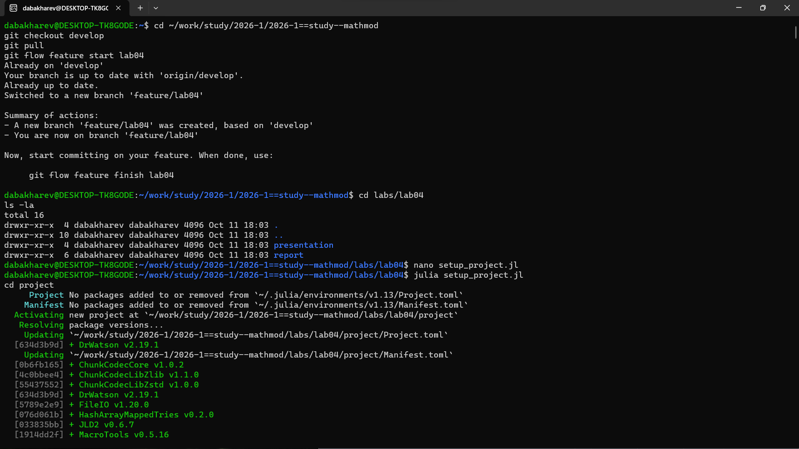
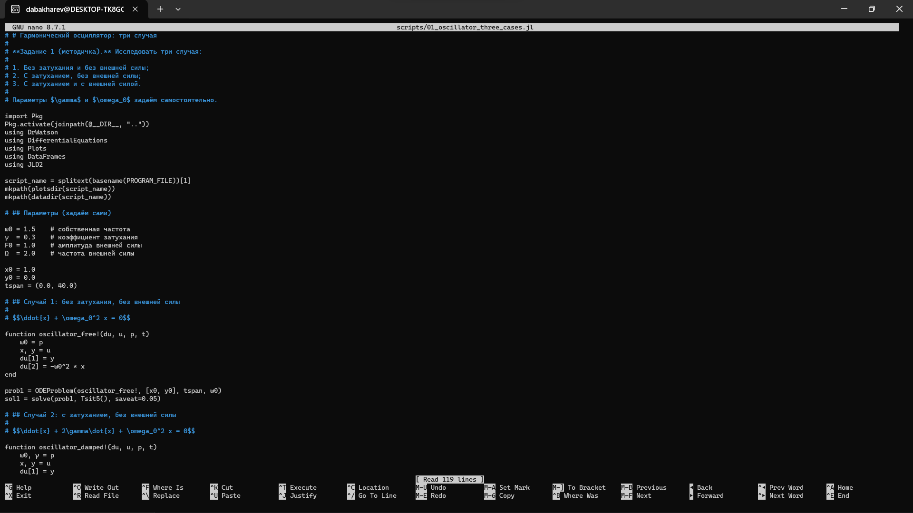
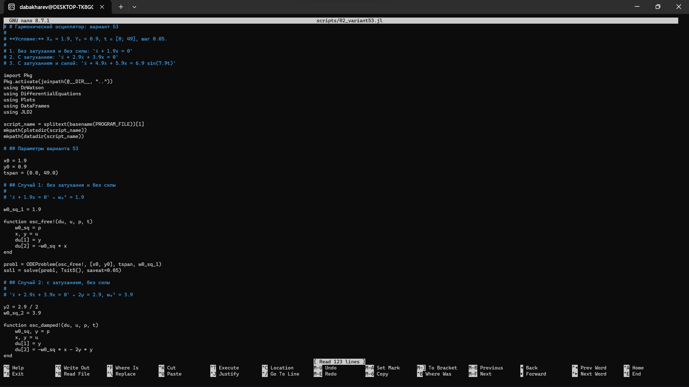
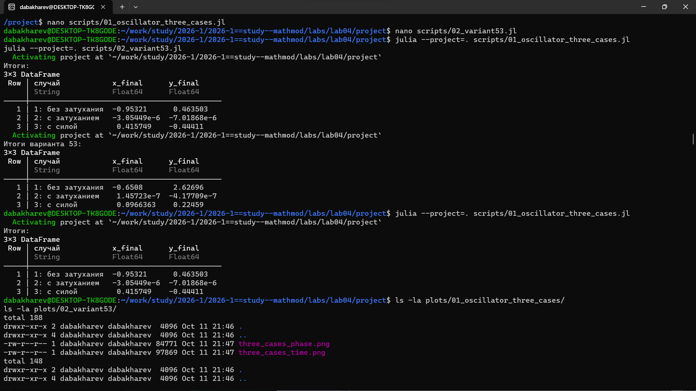
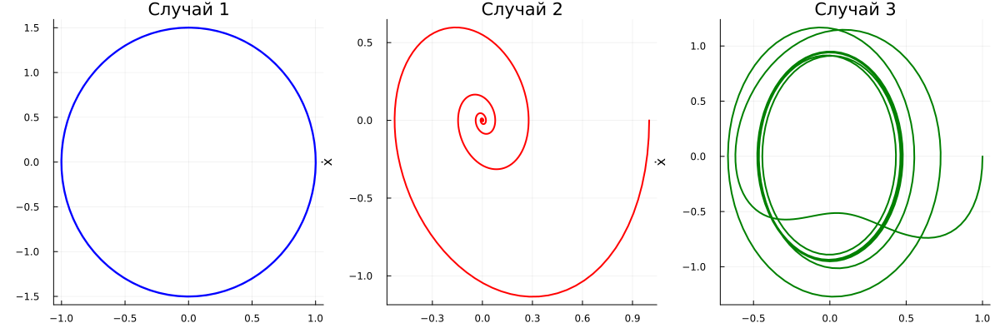
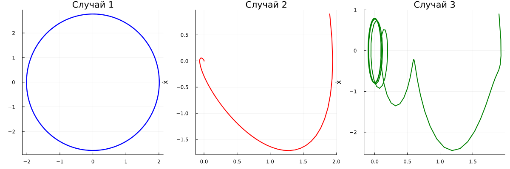
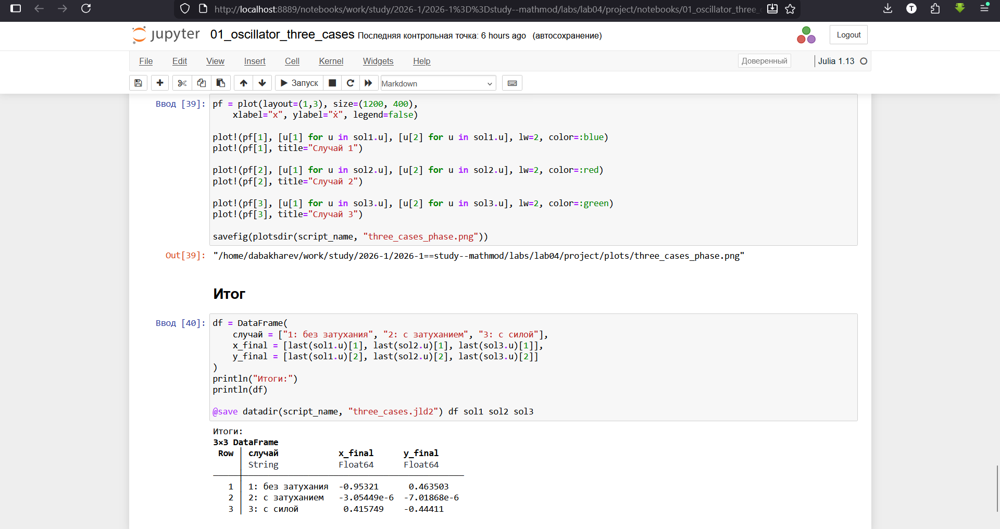
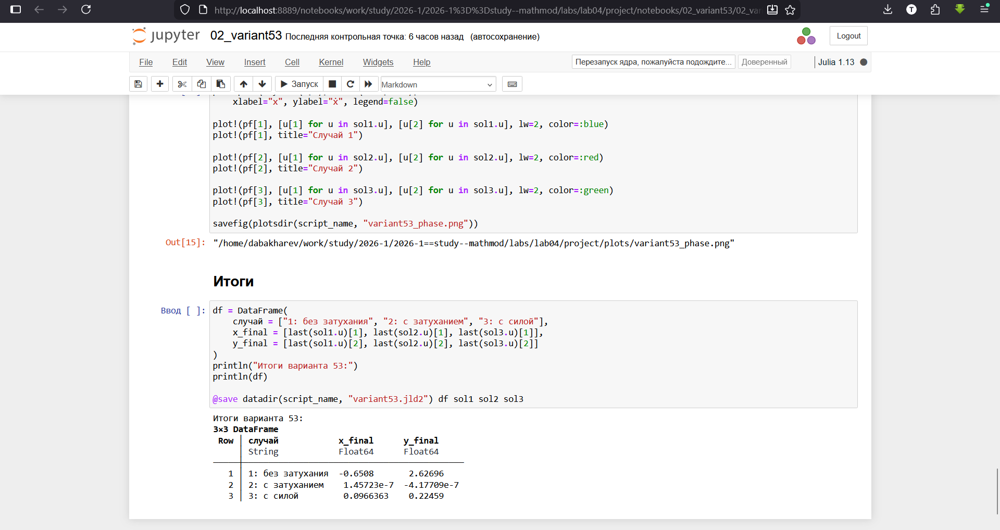

---
## Author
author:
  - name: Бахарев Дмитрий Александрович
    group: НКНбд-01-23
    email: traap.luuvv@mail.ru
    affiliation:
      - name: Российский университет дружбы народов
        country: Российская Федерация
        postal-code: 117198
        city: Москва
        address: ул. Миклухо-Маклая, д. 6
## Title
title: Лабораторная работа №4
subtitle: Гармонический осциллятор
license: CC BY
---

# Введение

## Актуальность

- Гармонический осциллятор — базовая модель теории колебаний.
- Применяется в механике, электротехнике, биологии, экономике.
- Описывает движение грузика, маятника, заряда в контуре.

## Цель и задачи

**Цель:** исследовать три случая гармонического осциллятора и освоить
численное решение ОДУ в Julia.

**Задачи:**

1. Изучить уравнение свободных колебаний осциллятора.
2. Реализовать три случая: без затухания, с затуханием, с внешней силой.
3. Построить временные ряды и фазовые портреты.
4. Решить задачу для варианта 53.

# Теоретическая часть

## Модель гармонического осциллятора

Уравнение свободных колебаний:

$$\ddot{x} + 2\gamma \dot{x} + \omega_0^2 x = 0,$$

где $\gamma$ — параметр затухания, $\omega_0$ — собственная частота.

## Три случая

**Случай 1** (без затухания): $\ddot{x} + \omega_0^2 x = 0$.

**Случай 2** (с затуханием): $\ddot{x} + 2\gamma \dot{x} + \omega_0^2 x = 0$.

**Случай 3** (с затуханием и внешней силой):
$\ddot{x} + 2\gamma \dot{x} + \omega_0^2 x = F_0 \sin(\Omega t)$.

## Вариант 53

- $x_0 = 1.9$, $y_0 = 0.9$, $t \in [0; 49]$.
- 1: $\ddot{x} + 1.9 x = 0$
- 2: $\ddot{x} + 2.9 \dot{x} + 3.9 x = 0$
- 3: $\ddot{x} + 4.9 \dot{x} + 5.9 x = 6.9 \sin(7.9 t)$

# Реализация

## Создание проекта DrWatson

{width=60%}

## Установка пакетов

{width=60%}

## Код скриптов

Скрипт `01_oscillator_three_cases.jl` реализует три случая осциллятора
(рис. 1).

{width=70%}

Скрипт `02_variant53.jl` решает задачу для варианта 53 (рис. 2).

{width=70%}

# Результаты

## Итоговые таблицы

{width=70%}

Для случая с затуханием значения стремятся к нулю.
Для консервативного случая и случая с внешней силой колебания сохраняются.

## Колебания без затухания

{width=70%}

## Фазовый портрет без затухания

{width=70%}

Фазовые траектории — замкнутые кривые (эллипсы), колебания периодичны.

## Колебания с затуханием

{width=70%}

## Фазовый портрет с затуханием

{width=70%}

Амплитуда затухает, система стремится к положению равновесия.

## Колебания с внешней силой

{width=70%}

## Фазовый портрет с внешней силой

{width=70%}

Под действием внешней силы колебания продолжаются, но амплитуда
меньше, чем в случае 1.

# Заключение

## Итоги

- Изучены три случая гармонического осциллятора.
- Реализованы численные решения в Julia.
- Построены временные ряды и фазовые портреты.
- Проведён анализ поведения системы.
- Отчёт собран в PDF и DOCX, презентация — в PDF/HTML/Markdown.

