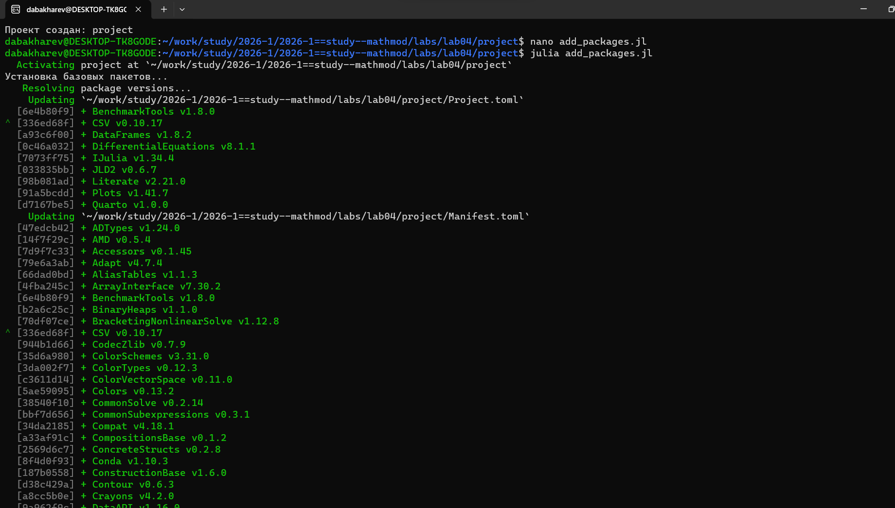
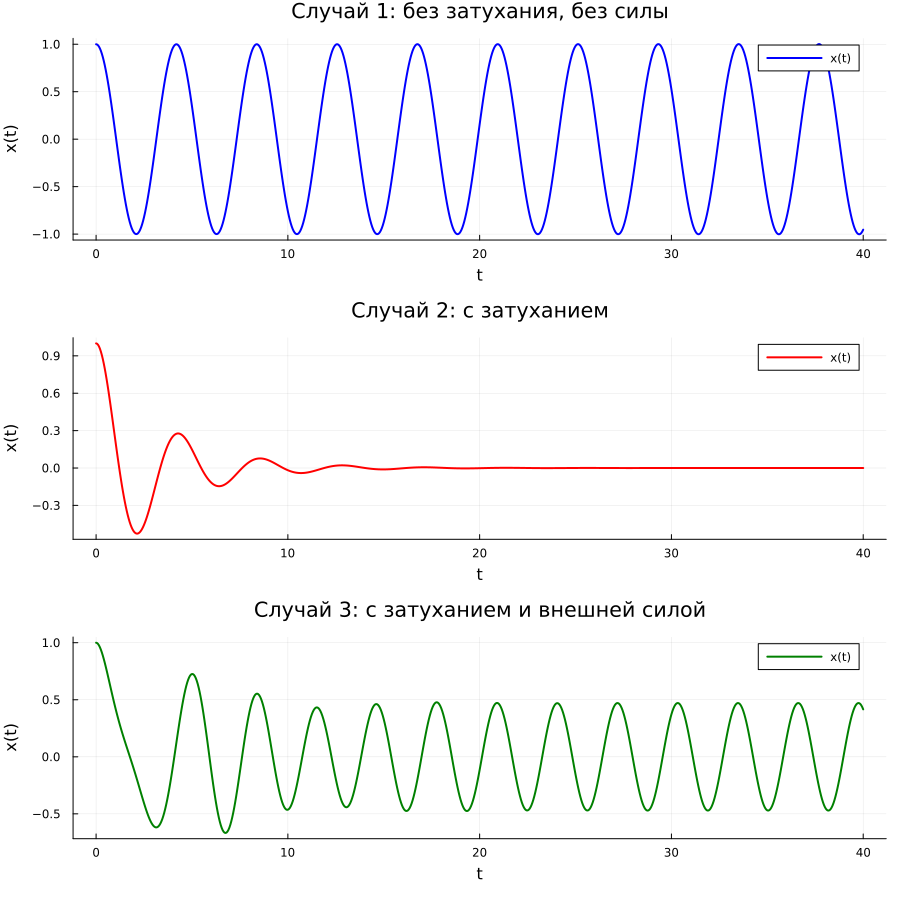
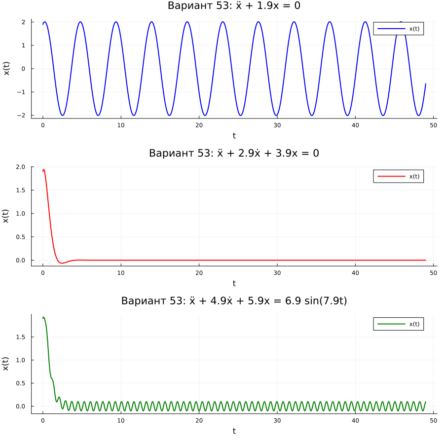

---
## Author
author:
  - name: Бахарев Дмитрий Александрович
    group: НКНбд-01-23
    email: traap.luuvv@mail.ru
    affiliation:
      - name: Российский университет дружбы народов
        country: Российская Федерация
        postal-code: 117198
        city: Москва
        address: ул. Миклухо-Маклая, д. 6
## Title
title: "Отчёт по лабораторной работе №4"
subtitle: "Гармонический осциллятор"
license: "CC BY"
---

# Цель работы

Исследовать математическую модель гармонического осциллятора
в трёх случаях: без затухания и без внешней силы, с затуханием,
с затуханием и внешней силой. Освоить численное решение ОДУ
второго порядка в Julia.

# Задание

## Вариант 53

Постройте фазовый портрет гармонического осциллятора и решение
уравнения гармонического осциллятора для следующих случаев:

1. Колебания гармонического осциллятора без затуханий и без действий
   внешней силы: $\ddot{x} + 1.9 x = 0$.
2. Колебания гармонического осциллятора с затуханием и без действий
   внешней силы: $\ddot{x} + 2.9 \dot{x} + 3.9 x = 0$.
3. Колебания гармонического осциллятора с затуханием и под действием
   внешней силы: $\ddot{x} + 4.9 \dot{x} + 5.9 x = 6.9 \sin(7.9 t)$.

На интервале $t \in [0; 49]$ (шаг $0.05$) с начальными условиями
$x_0 = 1.9$, $y_0 = 0.9$.

# Теоретическое введение

## Модель гармонического осциллятора

Гармонические колебания — колебания, при которых физическая величина
изменяется с течением времени по гармоническому (синусоидальному,
косинусоидальному) закону.

Гармонический осциллятор (в классической механике) — система, которая
при выведении её из положения равновесия испытывает действие
возвращающей силы $F$, пропорциональной смещению $x$.

Движение грузика на пружинке, маятника, заряда в электрическом
контуре, а также эволюция во времени многих систем в физике, химии,
биологии и других науках при определённых предположениях можно
описать одним и тем же дифференциальным уравнением, которое в теории
колебаний выступает в качестве основной модели. Эта модель называется
**линейным гармоническим осциллятором**.

Уравнение свободных колебаний гармонического осциллятора имеет вид:

$$\ddot{x} + 2\gamma \dot{x} + \omega_0^2 x = 0,$$

где $x$ — переменная, описывающая состояние системы, $\gamma$ —
параметр затухания, $\omega_0$ — собственная частота колебаний.

## Случай 1: без затухания и без внешней силы

При $\gamma = 0$ получаем уравнение консервативного осциллятора:

$$\ddot{x} + \omega_0^2 x = 0.$$

Система двух уравнений первого порядка:

$$
\begin{cases}
\dot{x} = y, \\
\dot{y} = -\omega_0^2 x.
\end{cases}
$$

## Случай 2: с затуханием, без внешней силы

$$\ddot{x} + 2\gamma \dot{x} + \omega_0^2 x = 0.$$

Система:

$$
\begin{cases}
\dot{x} = y, \\
\dot{y} = -\omega_0^2 x - 2\gamma y.
\end{cases}
$$

## Случай 3: с затуханием и внешней силой

$$\ddot{x} + 2\gamma \dot{x} + \omega_0^2 x = F_0 \sin(\Omega t).$$

Система:

$$
\begin{cases}
\dot{x} = y, \\
\dot{y} = -\omega_0^2 x - 2\gamma y + F_0 \sin(\Omega t).
\end{cases}
$$

Независимые переменные $x$, $y$ определяют **фазовое пространство**
системы. Кривая в фазовой плоскости называется **фазовой траекторией**,
а множество траекторий — **фазовым портретом**.

# Выполнение лабораторной работы

## Создание рабочего пространства

Ветка `feature/lab04` создана через Gitflow, затем инициализирован
проект DrWatson в каталоге `labs/lab04/project` (рис. @fig-1).

{#fig-1 width=70%}

## Установка пакетов

Пакеты Julia установлены в проект (рис. @fig-2).

{#fig-2 width=70%}

## Код скриптов

Скрипт `01_oscillator_three_cases.jl` реализует три случая осциллятора
(рис. @fig-10).

{#fig-10 width=70%}

Скрипт `02_variant53.jl` решает задачу для варианта 53 (рис. @fig-11).

{#fig-11 width=70%}

## Результаты расчётов

Итоговые значения для трёх случаев и варианта 53 приведены
на рис. @fig-3.

{#fig-3 width=70%}

Для случая с затуханием (без внешней силы) значения стремятся к нулю,
что соответствует затухающим колебаниям. Для консервативного случая
и случая с внешней силой колебания сохраняются.

## Колебания без затухания и без внешней силы

График решения для случая 1 приведён на рис. @fig-6.

{#fig-6 width=70%}

Фазовый портрет системы показан на рис. @fig-7.

{#fig-7 width=70%}

Колебания периодичны, график не затухает, решение движется по замкнутой
траектории — эллипсу.

## Колебания с затуханием, без внешней силы

График решения для случая 2 показан на рис. @fig-8.

{#fig-8 width=70%}

Фазовый портрет системы приведён на рис. @fig-9.

{#fig-9 width=70%}

Сначала происходят колебания осциллятора, затем амплитуда затухает
и система стремится к положению равновесия.

## Колебания с затуханием и внешней силой

Временные ряды для варианта 53 приведены на рис. @fig-12.

{#fig-12 width=70%}

Фазовый портрет системы для варианта 53 показан на рис. @fig-13.

{#fig-13 width=70%}

Система приходит в состояние равновесия, период колебаний больше,
чем в первом случае. Под действием внешней силы колебания продолжаются,
но амплитуда меньше.

## Листинги из Julia





# Вопросы к лабораторной работе

## 1. Простейшая модель гармонических колебаний

Простейшая модель описывается уравнением консервативного осциллятора:

$$\ddot{x} + \omega_0^2 x = 0,$$

где $x$ — смещение, $\omega_0$ — собственная частота колебаний.

## 2. Определение осциллятора

Осциллятор — система, совершающая колебания вблизи положения
равновесия. В общем случае:

$$\ddot{x} + 2\gamma \dot{x} + \omega_0^2 x = 0,$$

где $\gamma$ — параметр потерь энергии, $\omega_0$ — собственная частота.

## 3. Модель математического маятника

Для малых углов отклонения $\theta \ll 1$:

$$\ddot{\theta} + \frac{g}{l} \theta = 0,$$

где $g$ — ускорение свободного падения, $l$ — длина подвеса.
Собственная частота: $\omega_0 = \sqrt{g / l}$.

## 4. Алгоритм перехода от ДУ второго порядка к системе первого

1. Ввести новую переменную $y = \dot{x}$.
2. Выразить вторую производную: $\ddot{x} = \dot{y}$.
3. Подставить в исходное уравнение.
4. Записать систему:

$$
\begin{cases}
\dot{x} = y, \\
\dot{y} = -\omega_0^2 x.
\end{cases}
$$

## 5. Фазовый портрет и фазовая траектория

**Фазовый портрет** — графическое представление всех возможных
состояний системы в фазовом пространстве.

**Фазовая траектория** — кривая в фазовом пространстве, описывающая
изменение состояния системы во времени. Для гармонического осциллятора
фазовые траектории — замкнутые кривые (эллипсы), что указывает
на периодичность колебаний.

# Заключение

В ходе лабораторной работы №4:

- Изучены три случая гармонического осциллятора.
- Реализованы численные решения в Julia с использованием DrWatson.
- Построены временные ряды и фазовые портреты.
- Проведён анализ поведения системы при различных параметрах.
- Отчёт собран в PDF и DOCX, презентация — в PDF/HTML/Markdown.

# Список литературы {.unnumbered}

::: {#refs}
:::
