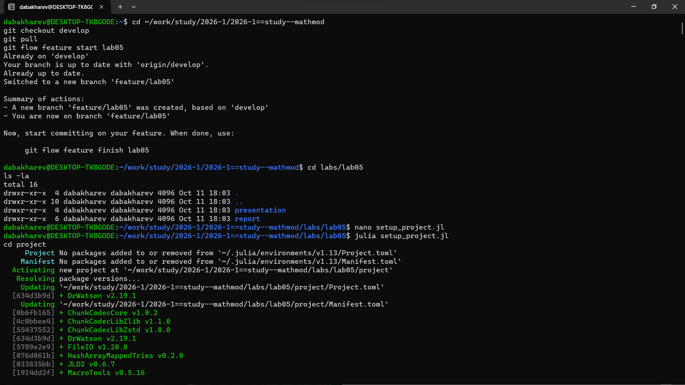
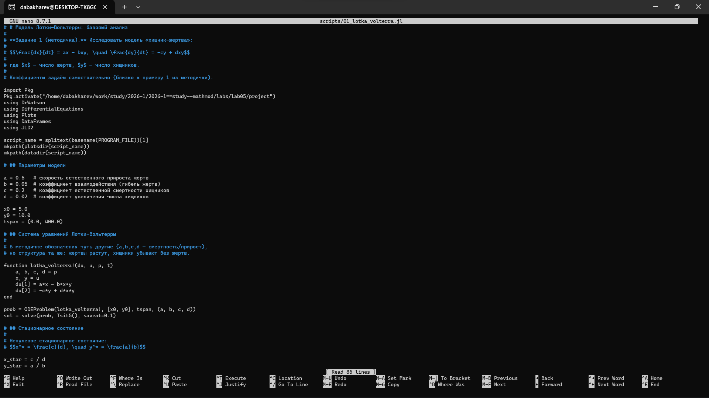
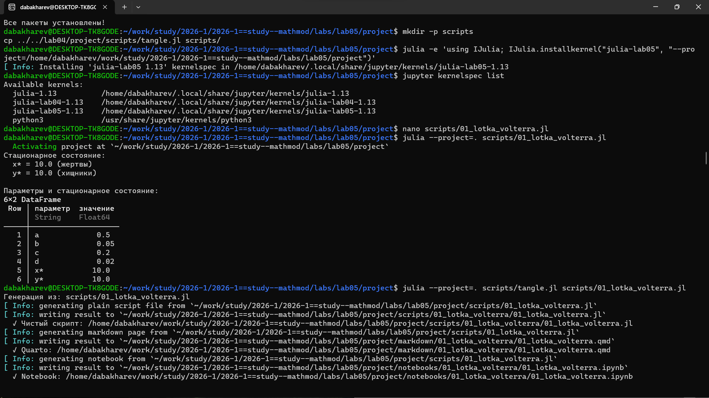
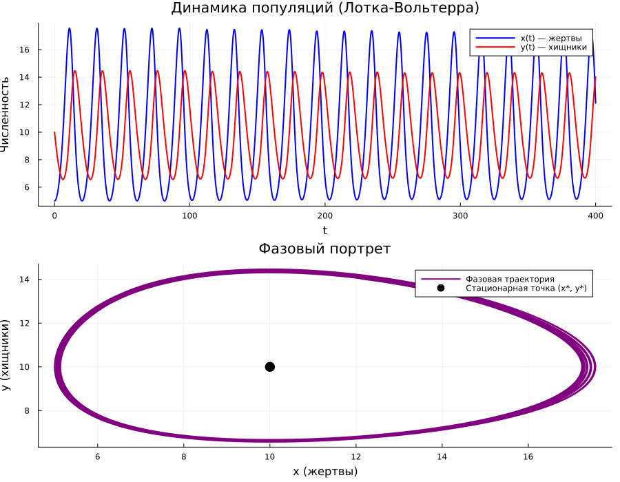
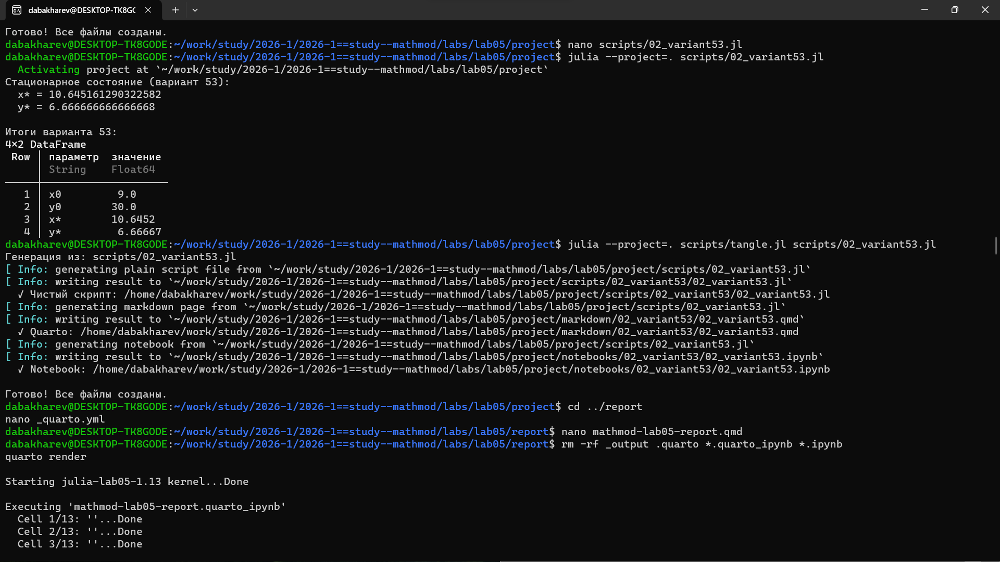

---
## Author
author:
  - name: Бахарев Дмитрий Александрович
    group: НКНбд-01-23
    email: traap.luuvv@mail.ru
    affiliation:
      - name: Российский университет дружбы народов
        country: Российская Федерация
        postal-code: 117198
        city: Москва
        address: ул. Миклухо-Маклая, д. 6
## Title
title: Лабораторная работа №5
subtitle: Модель Лотки-Вольтерра (хищник-жертва)
license: CC BY
---

# Введение

## Актуальность

- Модель «хищник-жертва» — одна из базовых моделей популяционной
  динамики.
- Применяется в экологии, биологии, экономике, эпидемиологии.
- Позволяет объяснить колебания численностей видов в природе.

## Цель и задачи

**Цель:** исследовать модель Лотки-Вольтерра и найти стационарное
состояние системы.

**Задачи:**

1. Изучить модель «хищник-жертва» Лотки-Вольтерра.
2. Реализовать численное решение в Julia.
3. Найти стационарное состояние.
4. Построить фазовый портрет и временные ряды.
5. Решить задачу для варианта 53.

# Теоретическая часть

## Модель Лотки-Вольтерра

Система уравнений:

$$
\begin{cases}
\dfrac{dx}{dt} = a x - b x y, \\[6pt]
\dfrac{dy}{dt} = -c y + d x y.
\end{cases}
$$

- $x$ — численность жертв;
- $y$ — численность хищников;
- $a$ — прирост жертв;
- $c$ — вымирание хищников.

## Стационарное состояние

Положение равновесия:

$$x^* = \frac{c}{d}, \quad y^* = \frac{a}{b}.$$

Решение в фазовой плоскости — **замкнутые кривые** (колебания
в противофазе).

## Вариант 53

$$
\begin{cases}
\dot{x} = -0.34 x + 0.051 x y, \\[6pt]
\dot{y} = 0.33 y - 0.031 x y.
\end{cases}
$$

Начальные условия: $x_0 = 9$, $y_0 = 30$.

# Реализация

## Создание проекта DrWatson

{width=60%}

## Установка пакетов

{width=60%}

## Код скриптов

Скрипт `01_lotka_volterra.jl` реализует базовую модель (рис. 1).

{width=70%}

Скрипт `02_variant53.jl` решает задачу для варианта 53 (рис. 2).

{width=70%}

# Результаты

## Запуск базового скрипта

- Стационарное состояние: $x^* = 10.0$, $y^* = 10.0$.
- Параметры: $a = 0.5$, $b = 0.05$, $c = 0.2$, $d = 0.02$.

{width=60%}

## Фазовый портрет базовой модели

{width=70%}

Решение в фазовой плоскости — замкнутая кривая, колебания
в противофазе.

## Запуск варианта 53

- Стационарное состояние: $x^* = 10.645$, $y^* = 6.667$.
- Начальные условия: $x_0 = 9.0$, $y_0 = 30.0$.

{width=60%}

## Фазовый портрет варианта 53

{width=70%}

## Jupyter-ноутбук базовой модели

{width=60%}

## Jupyter-ноутбук варианта 53

{width=60%}

# Заключение

## Итоги

- Изучена модель «хищник-жертва» Лотки-Вольтерра.
- Найдены стационарные состояния для базовой модели и варианта 53.
- Построены фазовые портреты и временные ряды.
- Реализованы численные решения в Julia.
- Отчёт собран в PDF и DOCX.

