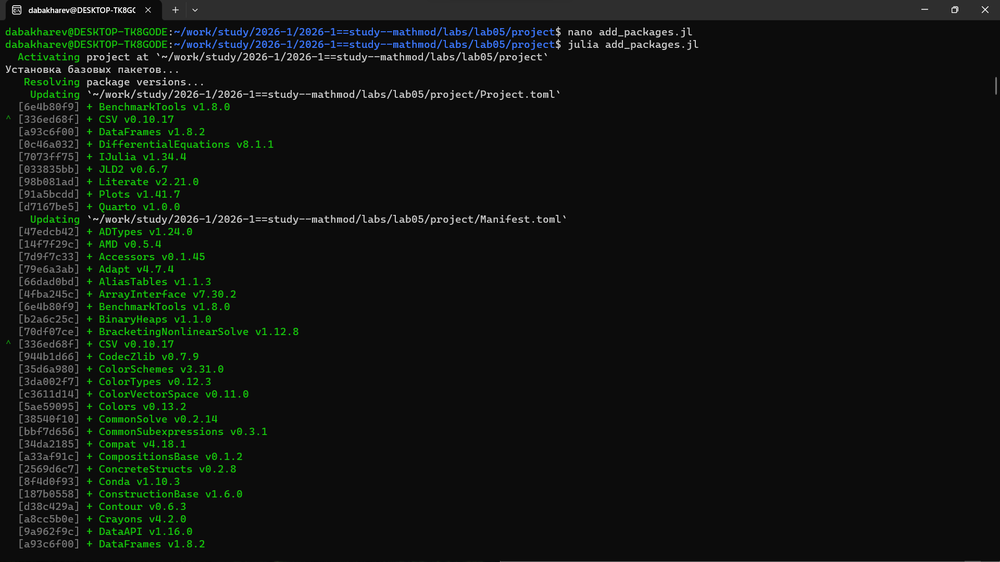
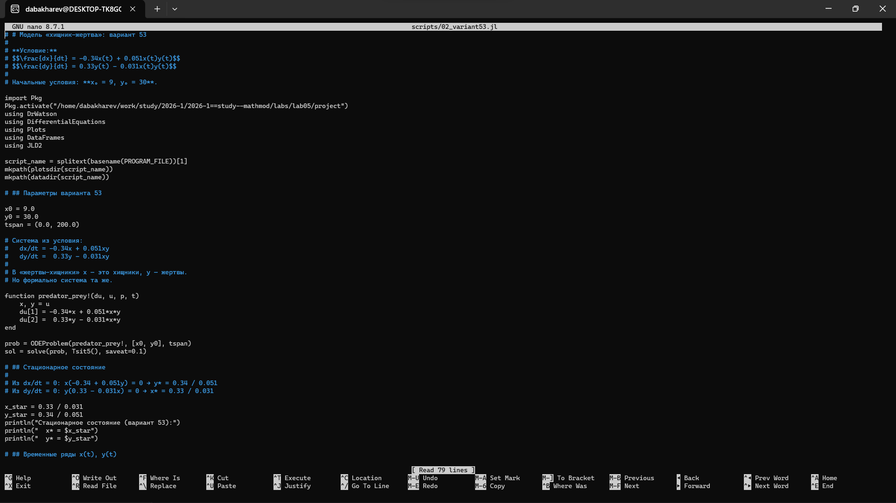
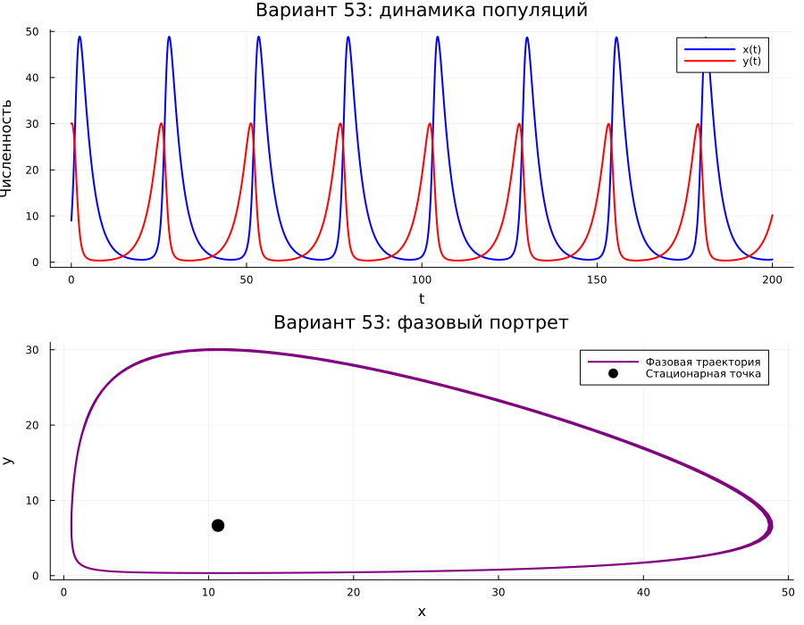
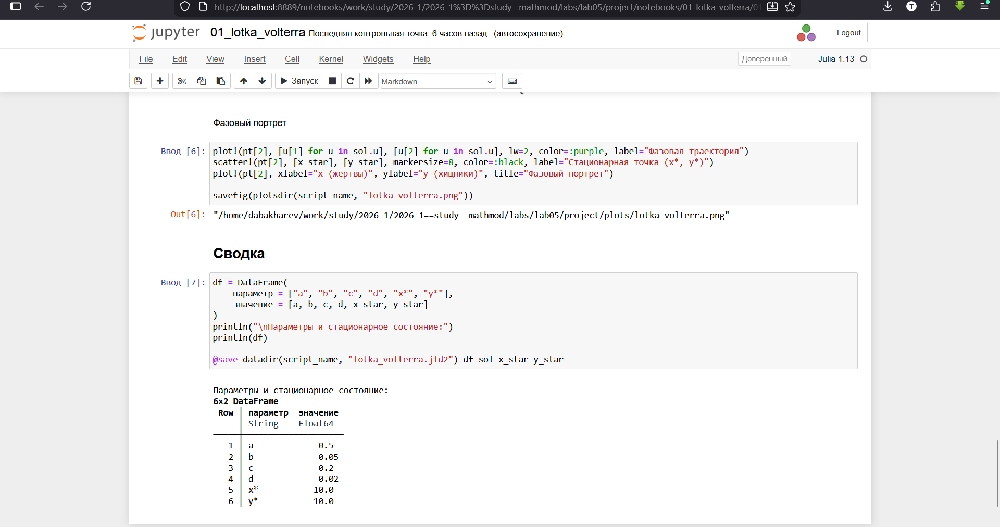
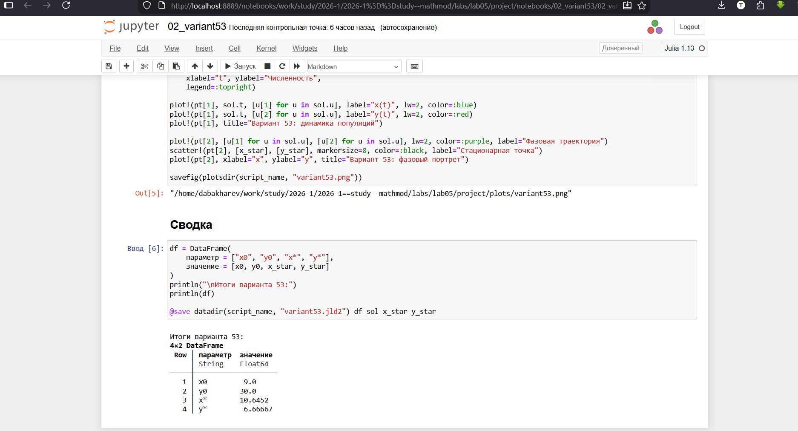

---
## Author
author:
  - name: Бахарев Дмитрий Александрович
    group: НКНбд-01-23
    email: traap.luuvv@mail.ru
    affiliation:
      - name: Российский университет дружбы народов
        country: Российская Федерация
        postal-code: 117198
        city: Москва
        address: ул. Миклухо-Маклая, д. 6
## Title
title: "Отчёт по лабораторной работе №5"
subtitle: "Модель Лотки-Вольтерра (хищник-жертва)"
license: "CC BY"
---

# Цель работы

Исследовать модель «хищник-жертва» Лотки-Вольтерра, найти стационарное
состояние системы, построить временные ряды и фазовые портреты.

# Задание

Для модели «хищник-жертва»:

$$
\begin{cases}
\dfrac{dx}{dt} = -0.34 x(t) + 0.051 x(t) y(t), \\[6pt]
\dfrac{dy}{dt} = 0.33 y(t) - 0.031 x(t) y(t).
\end{cases}
$$

Построить график зависимости численности хищников от численности жертв
(фазовый портрет), а также графики изменения численностей при начальных
условиях $x_0 = 9$, $y_0 = 30$. Найти стационарное состояние системы.

# Теоретическое введение

Простейшая модель взаимодействия двух видов типа «хищник-жертва» —
модель Лотки-Вольтерра. Она основана на следующих предположениях:

1. Численность популяций жертв $x$ и хищников $y$ зависят только
   от времени.
2. В отсутствие взаимодействия численность видов изменяется по модели
   Мальтуса: число жертв увеличивается, число хищников падает.
3. Естественная смертность жертвы и естественная рождаемость хищника
   считаются несущественными.
4. Эффект насыщения численности обеих популяций не учитывается.
5. Скорость роста численности жертв уменьшается пропорционально
   численности хищников.

Модель описывается системой:

$$
\begin{cases}
\dfrac{dx}{dt} = a x - b x y, \\[6pt]
\dfrac{dy}{dt} = -c y + d x y,
\end{cases}
$$

где $a$ — скорость естественного прироста жертв, $c$ — естественное
вымирание хищников, $b$ и $d$ — коэффициенты взаимодействия.

## Стационарное состояние

Положение равновесия (не зависящее от времени решение):

$$x^* = \frac{c}{d}, \quad y^* = \frac{a}{b}.$$

Если начальные значения задать в стационарном состоянии
$x(0) = x^*$, $y(0) = y^*$, то численности популяций изменяться
не будут.

## Фазовый портрет

Решение системы в фазовой плоскости $(x, y)$ представляет собой
замкнутые кривые — колебания численностей происходят в противофазе.
Амплитуда и период определяются начальными условиями.

# Выполнение лабораторной работы

## Создание рабочего пространства

Ветка `feature/lab05` создана через Gitflow, затем инициализирован
проект DrWatson в каталоге `labs/lab05/project` (рис. @fig-1).

{#fig-1 width=70%}

## Установка пакетов

Пакеты Julia установлены в проект (рис. @fig-2).

{#fig-2 width=70%}

## Код скриптов

Скрипт `01_lotka_volterra.jl` реализует базовую модель
(рис. @fig-7).

{#fig-7 width=70%}

Скрипт `02_variant53.jl` решает задачу для варианта 53 (рис. @fig-8).

{#fig-8 width=70%}

## Запуск базового скрипта

Создан кастомный kernel `julia-lab05` для Quarto. Скопирован `tangle.jl`
из lab04. Скрипт `01_lotka_volterra.jl` выполнен: найдено стационарное
состояние $x^* = 10.0$, $y^* = 10.0$ (рис. @fig-3).

{#fig-3 width=70%}

Параметры модели:

| Параметр | Значение |
|---|---|
| $a$ | 0.5 |
| $b$ | 0.05 |
| $c$ | 0.2 |
| $d$ | 0.02 |
| $x^*$ | 10.0 |
| $y^*$ | 10.0 |

Через `tangle.jl` сгенерированы три формата: чистый скрипт,
документация Quarto и Jupyter Notebook.

## Запуск скрипта варианта 53

Скрипт `02_variant53.jl` решает задачу для варианта 53. Найдено
стационарное состояние: $x^* = 10.645$, $y^* = 6.667$ (рис. @fig-4).

{#fig-4 width=70%}

Параметры варианта 53:

| Параметр | Значение |
|---|---|
| $x_0$ | 9.0 |
| $y_0$ | 30.0 |
| $x^*$ | 10.645 |
| $y^*$ | 6.667 |

## Результаты: базовый случай

Фазовый портрет и временные ряды для базовой модели приведены
на рис. @fig-5.

{#fig-5 width=70%}

## Результаты: вариант 53

Фазовый портрет и временные ряды для варианта 53 приведены
на рис. @fig-6.

{#fig-6 width=70%}

## Jupyter-ноутбуки

Jupyter-ноутбук `01_lotka_volterra.ipynb` выполнен (рис. @fig-9).

{#fig-9 width=70%}

Jupyter-ноутбук `02_variant53.ipynb` выполнен (рис. @fig-10).

{#fig-10 width=70%}

## Листинги из Julia





# Заключение

В ходе лабораторной работы №5:

- Изучена модель «хищник-жертва» Лотки-Вольтерра.
- Найдено стационарное состояние для базовой модели и варианта 53.
- Построены фазовые портреты и временные ряды.
- Реализованы численные решения в Julia с использованием DrWatson.
- Отчёт собран в PDF и DOCX, презентация — в PDF/HTML/Markdown.

# Список литературы {.unnumbered}

::: {#refs}
:::
