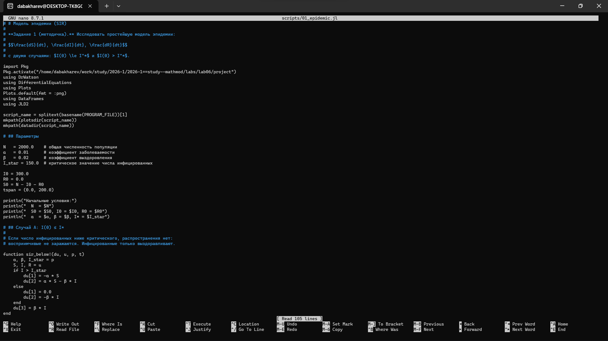
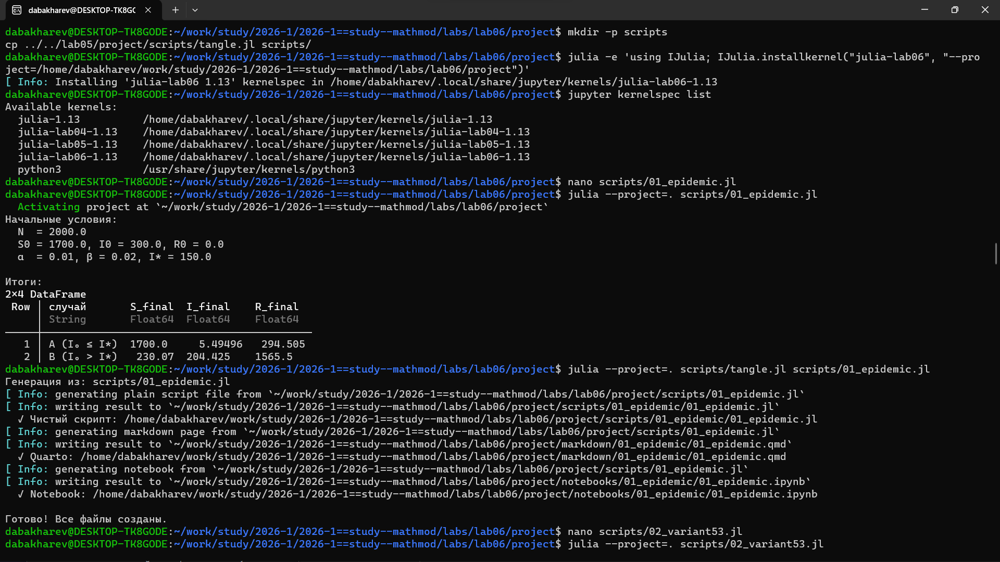
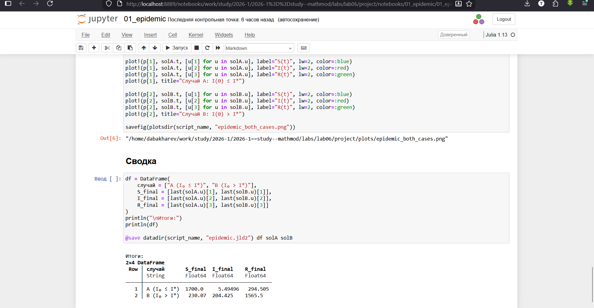

---
## Author
author:
  - name: Бахарев Дмитрий Александрович
    group: НКНбд-01-23
    email: traap.luuvv@mail.ru
    affiliation:
      - name: Российский университет дружбы народов
        country: Российская Федерация
        postal-code: 117198
        city: Москва
        address: ул. Миклухо-Маклая, д. 6
## Title
title: Лабораторная работа №6
subtitle: Модель эпидемии (SIR)
license: CC BY
---

# Введение

## Актуальность

- Модель SIR — базовая модель математической эпидемиологии.
- Применяется для прогнозирования распространения инфекций.
- Позволяет оценить влияние карантина и вакцинации.

## Цель и задачи

**Цель:** исследовать модель эпидемии SIR и построить графики
изменения численностей групп $S(t)$, $I(t)$, $R(t)$.

**Задачи:**

1. Изучить модель SIR.
2. Реализовать численное решение в Julia.
3. Рассмотреть два случая: $I(0) \le I^*$ и $I(0) > I^*$.
4. Решить задачу для варианта 53.

# Теоретическая часть

## Модель SIR

Три группы:
- $S(t)$ — восприимчивые;
- $I(t)$ — инфицированные;
- $R(t)$ — выздоровевшие с иммунитетом.

## Уравнения

$$
\begin{cases}
\dfrac{dS}{dt} = -\alpha S, \\[6pt]
\dfrac{dI}{dt} = \alpha S - \beta I, \\[6pt]
\dfrac{dR}{dt} = \beta I.
\end{cases}
$$

(при $I(t) > I^*$)

При $I(t) \le I^*$ заражения не происходят:
$\dfrac{dS}{dt} = 0$, $\dfrac{dI}{dt} = -\beta I$.

## Вариант 53

- $N = 6159$
- $I_0 = 173$, $R_0 = 61$, $S_0 = 5925$
- $\alpha = 0.01$, $\beta = 0.02$

# Реализация

## Создание проекта DrWatson

{width=60%}

## Установка пакетов

{width=60%}

## Код скриптов

Скрипт `01_epidemic.jl` реализует модель SIR (рис. 1).

{width=70%}

Скрипт `02_variant53.jl` решает задачу для варианта 53 (рис. 2).

{width=70%}

# Результаты

## Два случая

| Случай | $S_f$ | $I_f$ | $R_f$ |
|---|---|---|---|
| A ($I_0 \le I^*$) | 1700 | 5.5 | 294.5 |
| B ($I_0 > I^*$) | 230 | 204 | 1565 |

- Случай A: эпидемия не развивается.
- Случай B: развивается полноценная эпидемия.

{width=60%}

## Динамика групп: базовая модель

{width=70%}

## Вариант 53

| Случай | $S_f$ | $I_f$ | $R_f$ |
|---|---|---|---|
| A ($I_0 \le I^*$) | 5925 | 0.43 | 234 |
| B ($I_0 > I^*$) | 295 | 281 | 5583 |

{width=60%}

## Динамика групп: вариант 53

{width=70%}

## Jupyter-ноутбук базовой модели

{width=60%}

## Jupyter-ноутбук варианта 53

{width=60%}

# Заключение

## Итоги

- Изучена модель эпидемии SIR.
- Реализованы численные решения в Julia.
- Рассмотрены два случая (с развитием эпидемии и без).
- Решена задача для варианта 53.
- Отчёт собран в PDF и DOCX.

