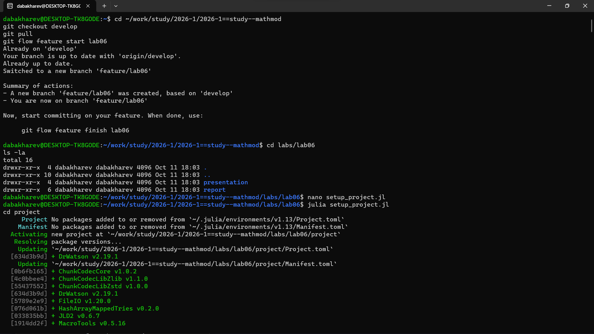
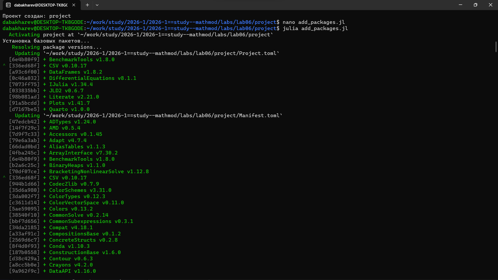
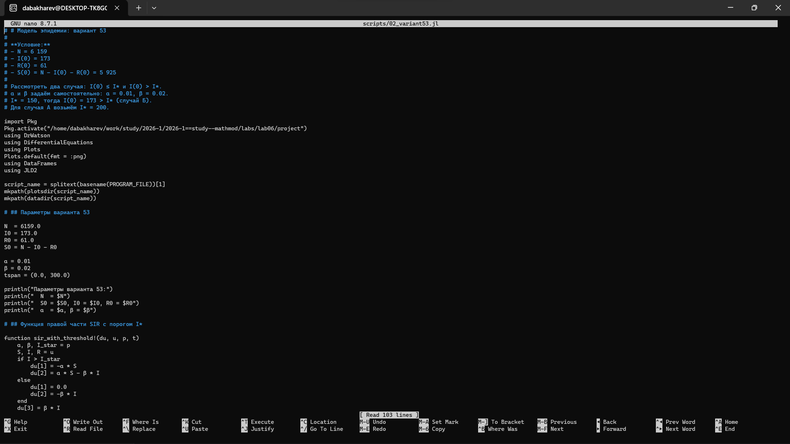
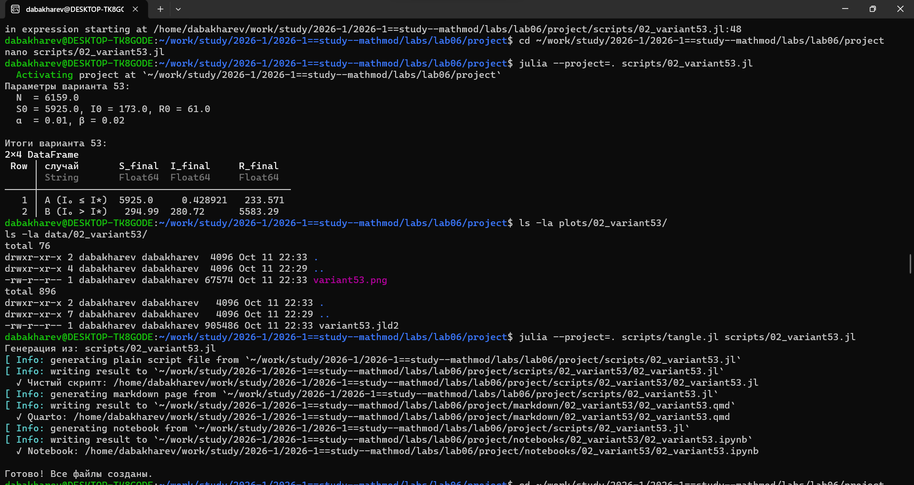
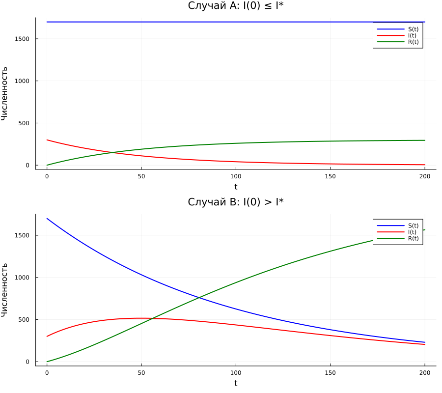
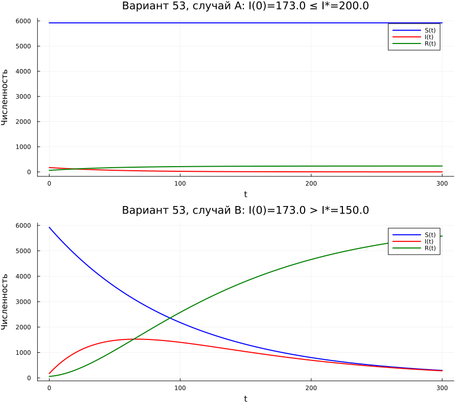
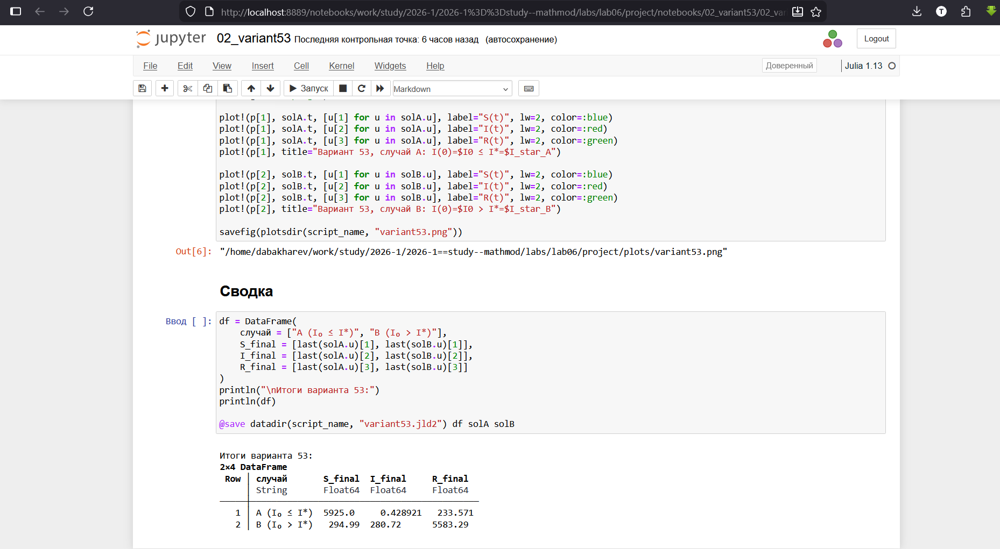

---
## Author
author:
  - name: Бахарев Дмитрий Александрович
    group: НКНбд-01-23
    email: traap.luuvv@mail.ru
    affiliation:
      - name: Российский университет дружбы народов
        country: Российская Федерация
        postal-code: 117198
        city: Москва
        address: ул. Миклухо-Маклая, д. 6
## Title
title: "Отчёт по лабораторной работе №6"
subtitle: "Модель эпидемии (SIR)"
license: "CC BY"
---

# Цель работы

Исследовать простейшую модель эпидемии SIR, построить графики
изменения численностей групп S(t), I(t), R(t) для двух случаев.

# Задание

Придумать свой пример задачи об эпидемии, задать начальные условия
и коэффициенты пропорциональности. Построить графики изменения числа
особей в каждой из трёх групп. Рассмотреть два случая:

- **а)** если $I(0) \le I^*$;
- **б)** если $I(0) > I^*$.

## Вариант 53

- $N = 6159$
- $I(0) = 173$
- $R(0) = 61$
- $S(0) = N - I(0) - R(0) = 5925$
- $\alpha = 0.01$, $\beta = 0.02$

# Теоретическое введение

Простейшая модель эпидемии предполагает, что популяция из $N$ особей
(изолированная) делится на три группы:

- $S(t)$ — восприимчивые к болезни, но пока здоровые;
- $I(t)$ — инфицированные, распространяющие инфекцию;
- $R(t)$ — здоровые с иммунитетом.

До того как число заболевших не превышает критического значения $I^*$,
считается, что все больные изолированы и не заражают здоровых.

Скорость изменения числа восприимчивых:

$$
\frac{dS}{dt} =
\begin{cases}
-\alpha S, & \text{если } I(t) > I^*, \\
0, & \text{если } I(t) \le I^*.
\end{cases}
$$

Скорость изменения числа инфицированных:

$$
\frac{dI}{dt} =
\begin{cases}
\alpha S - \beta I, & \text{если } I(t) > I^*, \\
-\beta I, & \text{если } I(t) \le I^*.
\end{cases}
$$

Скорость изменения выздоравливающих:

$$
\frac{dR}{dt} = \beta I.
$$

Постоянные $\alpha$, $\beta$ — коэффициенты заболеваемости
и выздоровления.

Начальные условия: $R(0) = 0$, $I(0)$ и $S(0)$ задаются.

# Выполнение лабораторной работы

## Создание рабочего пространства

Ветка `feature/lab06` создана через Gitflow, затем инициализирован
проект DrWatson в каталоге `labs/lab06/project` (рис. @fig-1).

{#fig-1 width=70%}

## Установка пакетов

Пакеты Julia установлены в проект (рис. @fig-2).

{#fig-2 width=70%}

## Код скриптов

Скрипт `01_epidemic.jl` реализует базовую модель SIR (рис. @fig-7).

{#fig-7 width=70%}

Скрипт `02_variant53.jl` решает задачу для варианта 53 (рис. @fig-8).

{#fig-8 width=70%}

## Запуск базового скрипта

Скрипт `01_epidemic.jl` выполнен для двух случаев (рис. @fig-3).

{#fig-3 width=70%}

Начальные условия: $N = 2000$, $S_0 = 1700$, $I_0 = 300$, $R_0 = 0$,
$\alpha = 0.01$, $\beta = 0.02$, $I^* = 150$.

| Случай | $S_{final}$ | $I_{final}$ | $R_{final}$ |
|---|---|---|---|
| A ($I_0 \le I^*$) | 1700.0 | 5.49 | 294.5 |
| B ($I_0 > I^*$) | 230.1 | 204.4 | 1565.5 |

В случае A эпидемия не развивается, так как число инфицированных
ниже критического порога. В случае B развивается полноценная эпидемия:
число восприимчивых резко падает, растёт число переболевших.

## Запуск скрипта варианта 53

Скрипт `02_variant53.jl` решает задачу для варианта 53 (рис. @fig-4).

{#fig-4 width=70%}

Параметры варианта 53: $N = 6159$, $S_0 = 5925$, $I_0 = 173$,
$R_0 = 61$, $\alpha = 0.01$, $\beta = 0.02$.

| Случай | $S_{final}$ | $I_{final}$ | $R_{final}$ |
|---|---|---|---|
| A ($I_0 \le I^*$) | 5925.0 | 0.43 | 233.6 |
| B ($I_0 > I^*$) | 295.0 | 280.7 | 5583.3 |

## Результаты: базовая модель

Динамика трёх групп для базовой модели приведена на рис. @fig-5.

{#fig-5 width=70%}

## Результаты: вариант 53

Динамика трёх групп для варианта 53 приведена на рис. @fig-6.

{#fig-6 width=70%}

## Jupyter-ноутбуки

Jupyter-ноутбук `01_epidemic.ipynb` выполнен (рис. @fig-9).

{#fig-9 width=70%}

Jupyter-ноутбук `02_variant53.ipynb` выполнен (рис. @fig-10).

{#fig-10 width=70%}

## Листинги из Julia





# Заключение

В ходе лабораторной работы №6:

- Изучена модель эпидемии SIR.
- Реализованы численные решения в Julia с использованием DrWatson.
- Рассмотрены два случая: с развитием эпидемии и без неё.
- Решена задача для варианта 53.
- Отчёт собран в PDF и DOCX, презентация — в PDF/HTML/Markdown.

# Список литературы {.unnumbered}

::: {#refs}
:::
