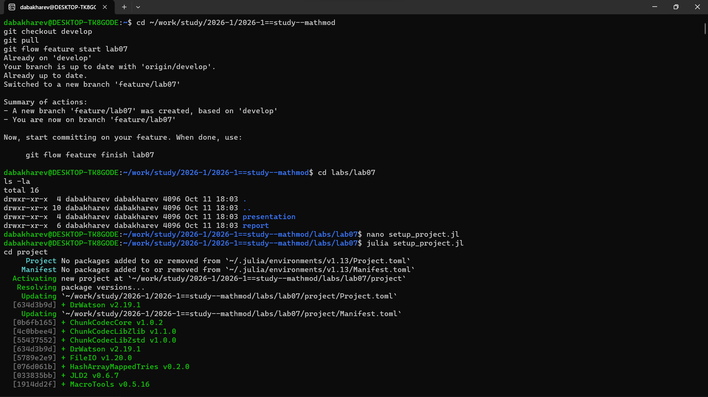
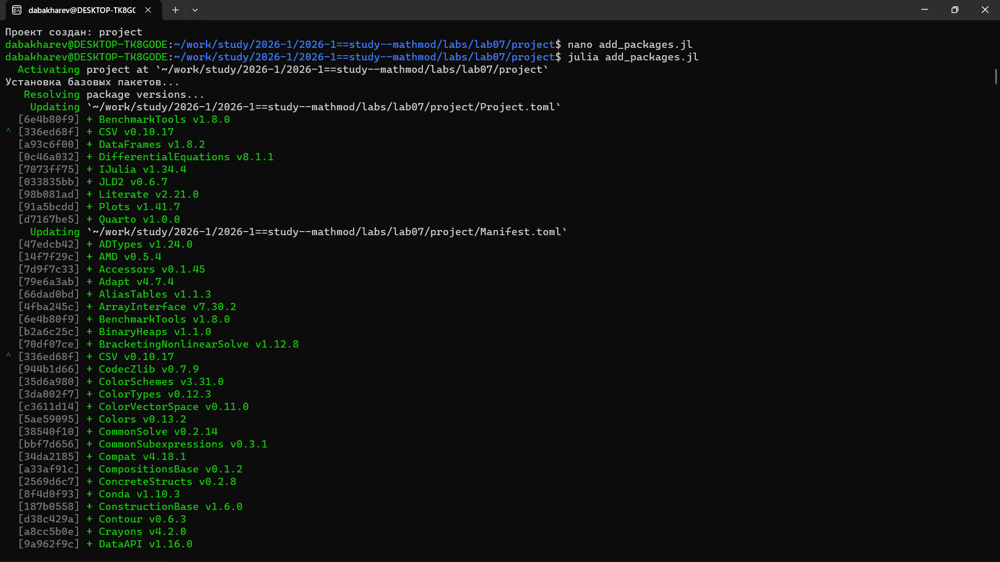
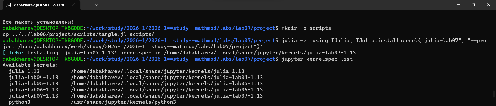
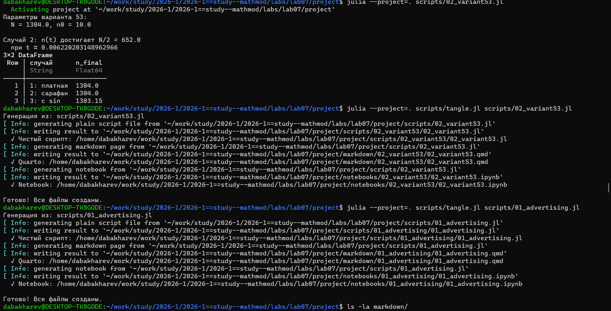
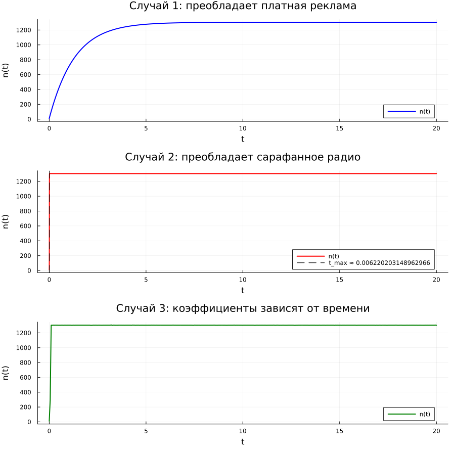
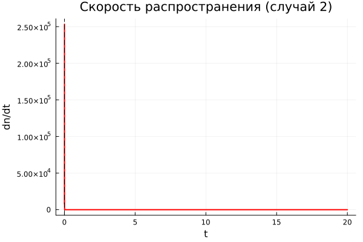
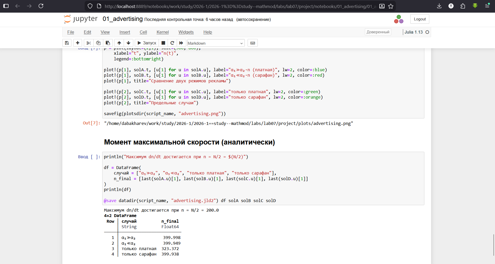

---
## Author
author:
  - name: Бахарев Дмитрий Александрович
    group: НКНбд-01-23
    email: traap.luuvv@mail.ru
    affiliation:
      - name: Российский университет дружбы народов
        country: Российская Федерация
        postal-code: 117198
        city: Москва
        address: ул. Миклухо-Маклая, д. 6
## Title
title: Лабораторная работа №7
subtitle: Модель распространения рекламы
license: CC BY
---

# Введение

## Актуальность

- Распространение рекламы — ключевая задача маркетинга.
- Два канала: платная реклама и «сарафанное радио».
- Математическая модель позволяет сравнить эффективность
  и предсказать охват аудитории.

## Цель и задачи

**Цель:** исследовать модель распространения рекламы и найти момент
максимальной скорости.

**Задачи:**

1. Изучить модель распространения рекламы.
2. Реализовать численное решение в Julia.
3. Сравнить платную рекламу и «сарафанное радио».
4. Решить задачу для варианта 53.

# Теоретическая часть

## Модель распространения рекламы

$$\frac{dn}{dt} = (\alpha_1(t) + \alpha_2(t) n(t))(N - n(t)).$$

- $\alpha_1(t)$ — платная реклама;
- $\alpha_2(t) n(t)$ — «сарафанное радио».

## Предельные случаи

**Мальтус** ($\alpha_1 \gg \alpha_2$):

$$\frac{dn}{dt} \approx \alpha_1 (N - n).$$

**Логистика** ($\alpha_1 \ll \alpha_2$):

$$\frac{dn}{dt} \approx \alpha_2 n (N - n).$$

Максимум скорости при $n = N/2$.

## Вариант 53

- $N = 1304$, $n_0 = 10$.
- 1: $\alpha_1 = 0.76$, $\alpha_2 = 0.000016$
- 2: $\alpha_1 = 0.000016$, $\alpha_2 = 0.6$
- 3: $\alpha_1 = 0.7 \sin(7t)$, $\alpha_2 = 0.7 \sin(3t)$

# Реализация

## Создание проекта DrWatson

{width=60%}

## Установка пакетов

{width=60%}

## Настройка окружения

{width=60%}

## Код скриптов

Скрипт `01_advertising.jl` (рис. 1):

{width=70%}

Скрипт `02_variant53.jl` (рис. 2):

{width=70%}

# Результаты

## Базовый скрипт: 4 случая

| Случай | $n_f$ |
|---|---|
| α₁≫α₂ | 400.0 |
| α₁≪α₂ | 399.9 |
| только платная | 323.4 |
| только сарафан | 399.9 |

{width=60%}

## Вариант 53

- Случай 2: $n \to N/2 = 652$ при $t \approx 0.0062$ — точка максимума
  скорости.

| Случай | $n_f$ |
|---|---|
| 1: платная | 1304 |
| 2: сарафан | 1304 |
| 3: с sin | 1303.2 |

{width=60%}

## График распространения

{width=70%}

## Скорость распространения

{width=70%}

## Jupyter-ноутбук

{width=60%}

# Вопросы к лабораторной работе

## 1. Модель Мальтуса

$$\frac{dn}{dt} = \alpha n, \quad n(t) = n_0 e^{\alpha t}.$$

Используется в биологии, эпидемиологии, экономике.

## 2. Логистическая кривая

$$\frac{dn}{dt} = \alpha n \left(1 - \frac{n}{N}\right).$$

S-образный рост с насыщением.

## 3. Коэффициенты

- $\alpha_1$ — платная реклама.
- $\alpha_2 n$ — сарафанное радио.

## 4. При $\alpha_1 \ge \alpha_2$

Плавный S-образный рост (модель Мальтуса).

## 5. При $\alpha_1 \le \alpha_2$

Лавинообразный рост (логистика), пик при $n = N/2$.

# Заключение

## Итоги

- Изучена модель распространения рекламы.
- Сравнены платная реклама и «сарафанное радио».
- Найден момент максимальной скорости (вариант 53).
- Отчёт собран в PDF и DOCX.

