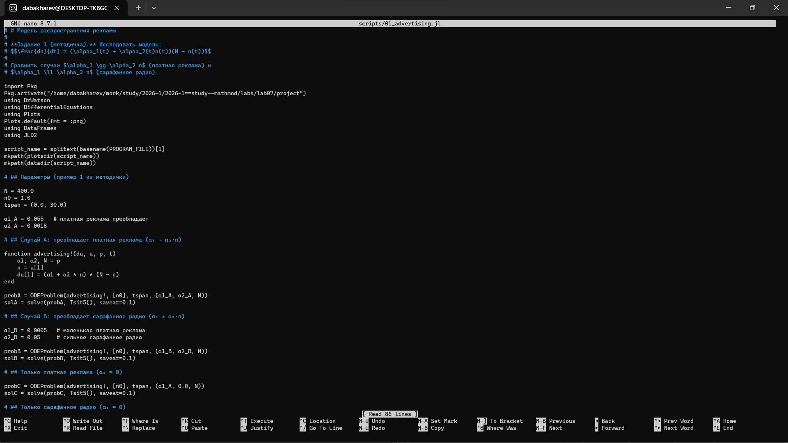
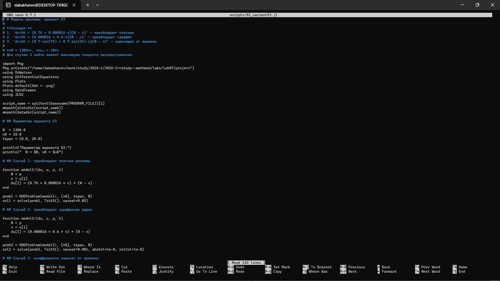
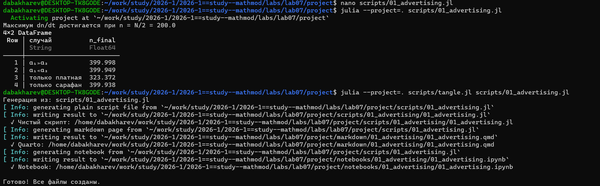

---
## Author
author:
  - name: Бахарев Дмитрий Александрович
    group: НКНбд-01-23
    email: traap.luuvv@mail.ru
    affiliation:
      - name: Российский университет дружбы народов
        country: Российская Федерация
        postal-code: 117198
        city: Москва
        address: ул. Миклухо-Маклая, д. 6
## Title
title: "Отчёт по лабораторной работе №7"
subtitle: "Модель распространения рекламы"
license: "CC BY"
---

# Цель работы

Исследовать модель распространения рекламы, сравнить эффективность
платной рекламы и «сарафанного радио», найти момент максимальной
скорости распространения.

# Задание

Модель распространения рекламы:

$$\frac{dn}{dt} = (\alpha_1(t) + \alpha_2(t) n(t))(N - n(t)),$$

где $n(t)$ — число знающих о товаре, $N$ — объём аудитории.

## Вариант 53

- $N = 1304$, $n_0 = 10$.
- **Модель 1** (платная преобладает): $\alpha_1 = 0.76$, $\alpha_2 = 0.000016$.
- **Модель 2** (сарафан преобладает): $\alpha_1 = 0.000016$, $\alpha_2 = 0.6$.
- **Модель 3** (зависит от времени): $\alpha_1(t) = 0.7 \sin(7t)$, $\alpha_2(t) = 0.7 \sin(3t)$.

Для модели 2 найти момент максимальной скорости распространения.

# Теоретическое введение

Модель распространения рекламы описывается уравнением:

$$\frac{dn}{dt} = (\alpha_1(t) + \alpha_2(t) n(t))(N - n(t)).$$

- $\alpha_1(t)$ — интенсивность **платной рекламы** (ТВ, радио).
- $\alpha_2(t) n(t)$ — вклад **сарафанного радио** (растёт с числом
  знающих).

## Модель Мальтуса

При $\alpha_1 \gg \alpha_2 n$ модель ведёт себя как **модель Мальтуса**:

$$\frac{dn}{dt} \approx \alpha_1 (N - n).$$

## Логистическая кривая

При $\alpha_1 \ll \alpha_2 n$ модель ведёт себя как **логистическая**:

$$\frac{dn}{dt} \approx \alpha_2 n (N - n).$$

Максимум скорости достигается при $n = N/2$.

# Выполнение лабораторной работы

## Создание рабочего пространства

Ветка `feature/lab07` создана через Gitflow, затем инициализирован
проект DrWatson в каталоге `labs/lab07/project` (рис. @fig-1).

{#fig-1 width=70%}

## Установка пакетов

Пакеты Julia установлены в проект (рис. @fig-2).

{#fig-2 width=70%}

## Настройка окружения

Скопирован `tangle.jl` из lab06. Создан кастомный kernel `julia-lab07`
для Quarto (рис. @fig-3).

{#fig-3 width=70%}

## Код скриптов

Скрипт `01_advertising.jl` реализует базовую модель (рис. @fig-8).

{#fig-8 width=70%}

Скрипт `02_variant53.jl` решает задачу для варианта 53 (рис. @fig-9).

{#fig-9 width=70%}

## Запуск базового скрипта

Скрипт `01_advertising.jl` выполнен для 4 случаев (рис. @fig-4).

{#fig-4 width=70%}

Максимум скорости $\frac{dn}{dt}$ достигается при $n = N/2 = 200$.

| Случай | $n_{final}$ |
|---|---|
| $\alpha_1 \gg \alpha_2$ (платная преобладает) | 399.998 |
| $\alpha_1 \ll \alpha_2$ (сарафан преобладает) | 399.949 |
| только платная реклама | 323.372 |
| только сарафанное радио | 399.938 |

С сарафанным радио охват достигает $\sim 400$ (все потенциальные
клиенты). Без него (только платная) — только 323 из 400,
так как реклама не подхватывается «сарафаном».

## Запуск скрипта варианта 53

Скрипт `02_variant53.jl` решает задачу для варианта 53 (рис. @fig-5).

{#fig-5 width=70%}

Параметры: $N = 1304$, $n_0 = 10$.

| Случай | $n_{final}$ |
|---|---|
| 1: платная реклама преобладает | 1304.0 |
| 2: сарафанное радио преобладает | 1304.0 |
| 3: коэффициенты зависят от времени ($\sin$) | 1303.15 |

**Момент максимальной скорости** (случай 2) достигается, когда
$n(t) = N/2 = 652$, что соответствует $t \approx 0.0062$.

## Результаты: вариант 53

График распространения рекламы для варианта 53 приведён
на рис. @fig-6.

{#fig-6 width=70%}

Скорость распространения рекламы для случая 2 показана
на рис. @fig-7.

{#fig-7 width=70%}

## Jupyter-ноутбук

Jupyter-ноутбук `01_advertising.ipynb` выполнен (рис. @fig-10).

{#fig-10 width=70%}

## Листинги из Julia





# Вопросы к лабораторной работе

## 1. Модель Мальтуса

Модель Мальтуса описывает экспоненциальный рост:

$$\frac{dn}{dt} = \alpha n, \quad n(t) = n_0 e^{\alpha t}.$$

Используется в биологии, эпидемиологии, экономике.
В модели рекламы — частный случай при $\alpha_1 \gg \alpha_2$.

## 2. Уравнение логистической кривой

$$\frac{dn}{dt} = \alpha n \left(1 - \frac{n}{N}\right).$$

Описывает рост с насыщением (S-образная кривая).
В модели рекламы — случай $\alpha_1 \ll \alpha_2$.

## 3. Коэффициенты $\alpha_1(t)$ и $\alpha_2(t)$

- $\alpha_1(t)$ — интенсивность платной рекламы.
- $\alpha_2(t) n(t)$ — вклад сарафанного радио.

## 4. Поведение при $\alpha_1 \ge \alpha_2$

При преобладании платной рекламы модель ведёт себя как модель Мальтуса:
плавный S-образный рост, постепенное насыщение.

## 5. Поведение при $\alpha_1 \le \alpha_2$

При преобладании сарафанного радио модель лавинообразная:
быстрый рост, пик скорости при $n = N/2$, быстрое насыщение.

# Заключение

В ходе лабораторной работы №7:

- Изучена модель распространения рекламы.
- Реализованы численные решения в Julia.
- Сравнены платная реклама и «сарафанное радио».
- Найден момент максимальной скорости для варианта 53.
- Отчёт собран в PDF и DOCX, презентация — в PDF/HTML/Markdown.

# Список литературы {.unnumbered}

::: {#refs}
:::
