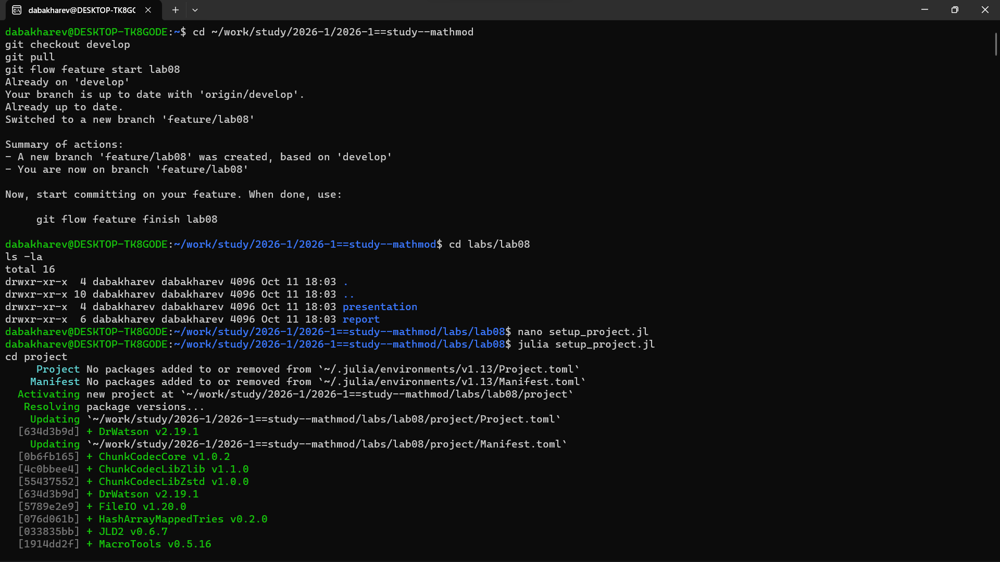
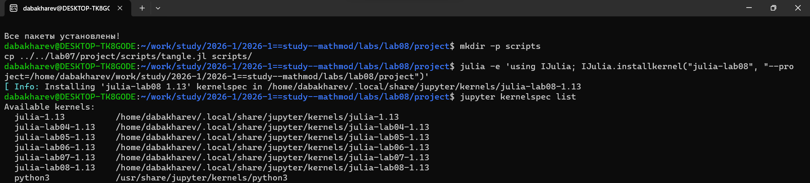
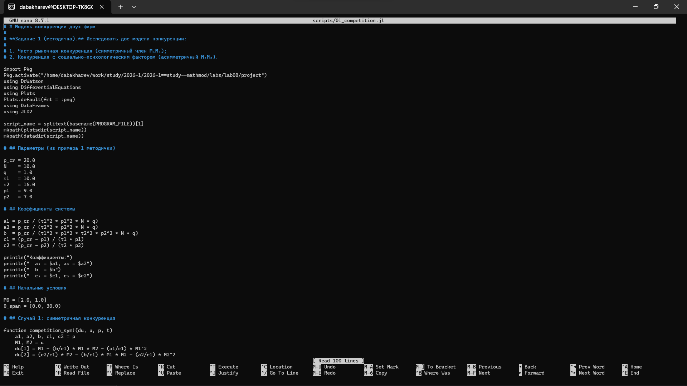
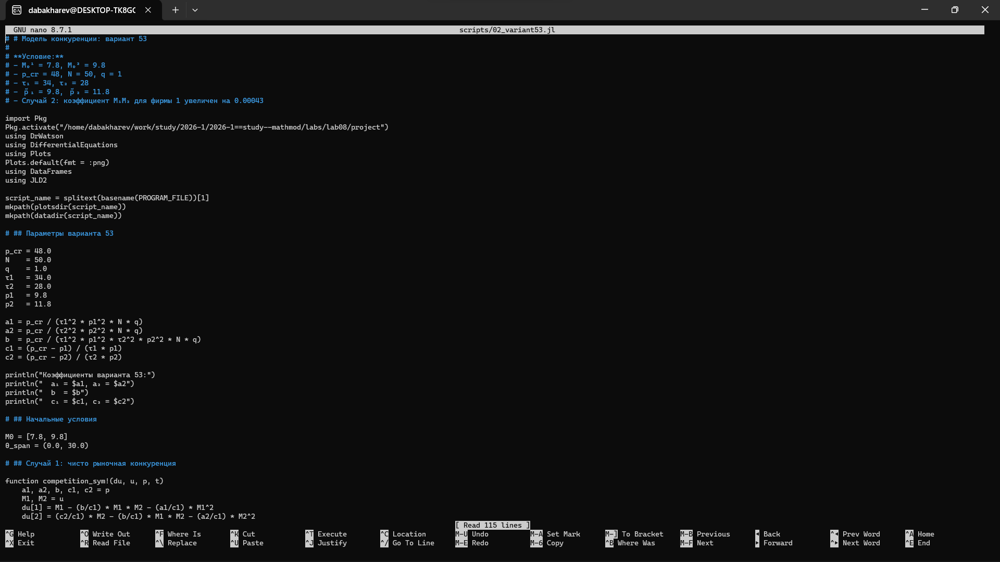
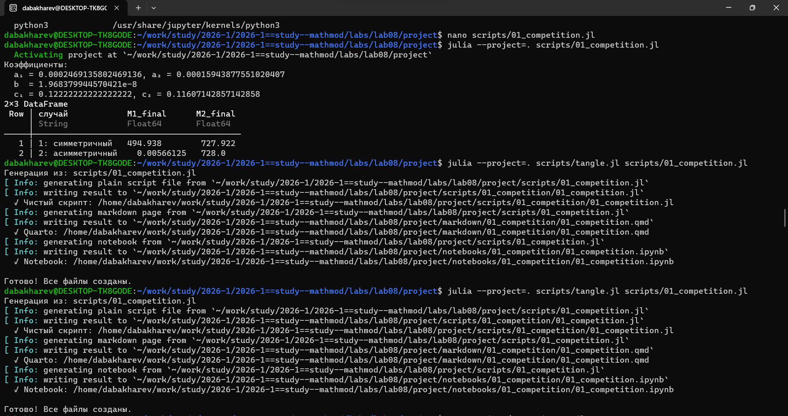
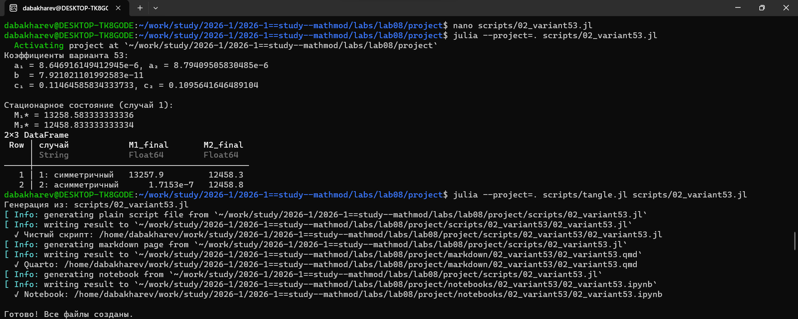
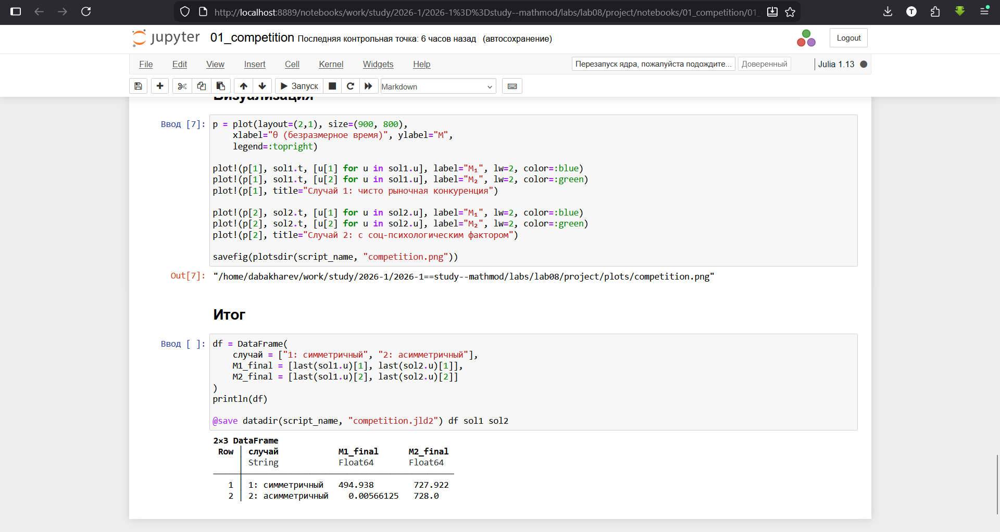

---
## Author
author:
  - name: Бахарев Дмитрий Александрович
    group: НКНбд-01-23
    email: traap.luuvv@mail.ru
    affiliation:
      - name: Российский университет дружбы народов
        country: Российская Федерация
        postal-code: 117198
        city: Москва
        address: ул. Миклухо-Маклая, д. 6
## Title
title: Лабораторная работа №8
subtitle: Модель конкуренции двух фирм
license: CC BY
---

# Введение

## Актуальность

- Конкуренция двух фирм — классическая задача рыночной экономики.
- Модель позволяет оценить выживаемость фирм.
- Учитывает экономические и социально-психологические факторы.

## Цель и задачи

**Цель:** исследовать модель конкуренции двух фирм и найти
стационарное состояние.

**Задачи:**

1. Изучить модель конкуренции двух фирм.
2. Реализовать численное решение в Julia.
3. Рассмотреть симметричный и асимметричный случаи.
4. Решить задачу для варианта 53.

# Теоретическая часть

## Модель двух фирм

$$
\begin{cases}
\dfrac{dM_1}{d\theta} = M_1 - \dfrac{b}{c_1} M_1 M_2 - \dfrac{a_1}{c_1} M_1^2, \\[6pt]
\dfrac{dM_2}{d\theta} = \dfrac{c_2}{c_1} M_2 - \dfrac{b}{c_1} M_1 M_2 - \dfrac{a_2}{c_1} M_2^2.
\end{cases}
$$

## Стационарное состояние

$$M_1^* = \frac{c_1}{a_1}, \quad M_2^* = \frac{c_2}{a_2}.$$

- **Симметричный:** обе фирмы выживают.
- **Асимметричный:** одна фирма разоряется.

## Вариант 53

- $M_0^1 = 7.8$, $M_0^2 = 9.8$
- $p_{cr} = 48$, $N = 50$, $q = 1$
- $\tau_1 = 34$, $\tau_2 = 28$
- Случай 2: $\delta = 0.00043$

# Реализация

## Создание проекта DrWatson

{width=60%}

## Установка пакетов

{width=60%}

## Настройка окружения

{width=60%}

## Код скриптов

Скрипт `01_competition.jl` (рис. 1):

{width=70%}

Скрипт `02_variant53.jl` (рис. 2):

{width=70%}

# Результаты

## Базовая модель

| Случай | $M_1^f$ | $M_2^f$ |
|---|---|---|
| 1: симметричный | 494.9 | 727.9 |
| 2: асимметричный | 0.006 | 728.0 |

{width=60%}

## Графики базовой модели

{width=70%}

## Вариант 53

| Случай | $M_1^f$ | $M_2^f$ |
|---|---|---|
| 1: симметричный | 13258 | 12458 |
| 2: асимметричный | ~0 | 12459 |

В случае 2 первая фирма **разоряется** — вторая побеждает.

{width=60%}

## Графики варианта 53

{width=70%}

## Jupyter-ноутбук базовой модели

{width=60%}

## Jupyter-ноутбук варианта 53

{width=60%}

# Заключение

## Итоги

- Изучена модель конкуренции двух фирм.
- Реализованы численные решения в Julia.
- Найдены стационарные состояния.
- Рассмотрены симметричный и асимметричный случаи.
- Отчёт собран в PDF и DOCX.

