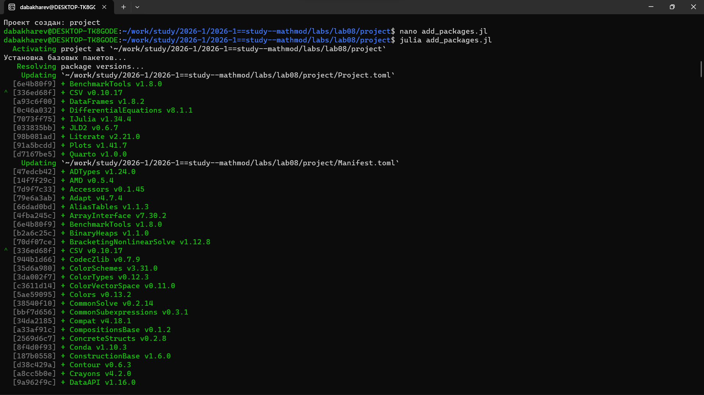
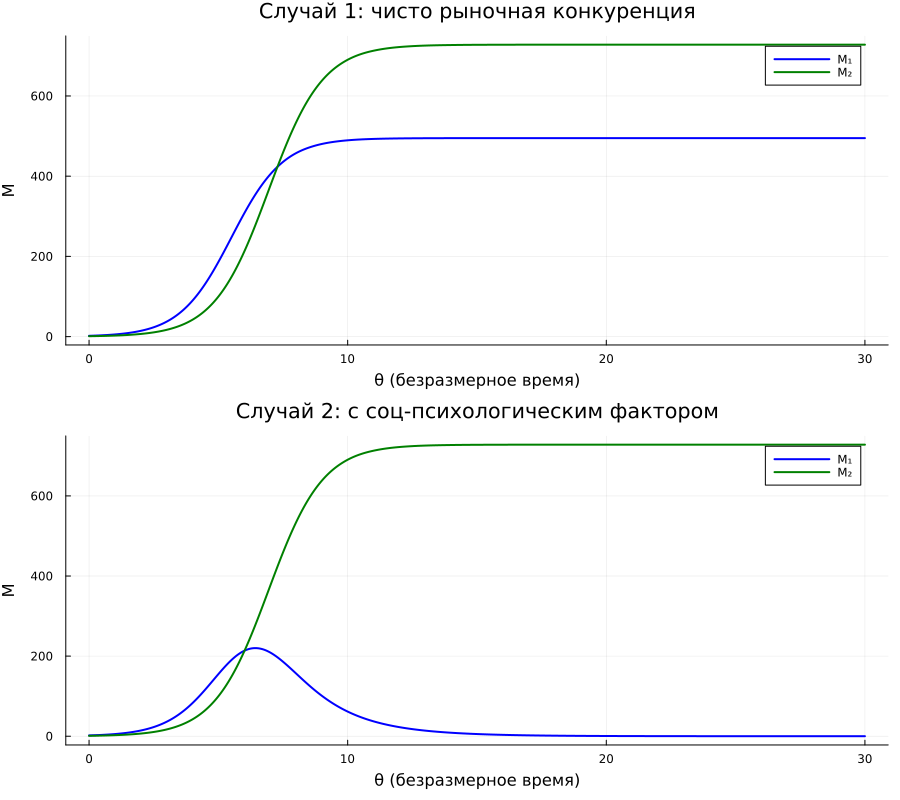
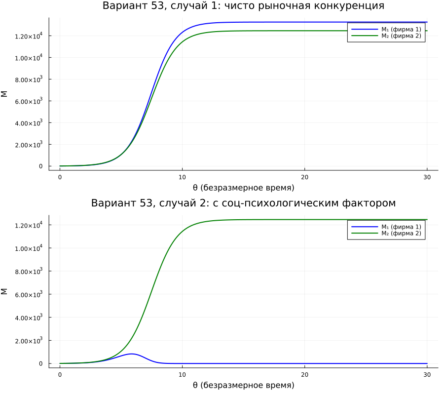
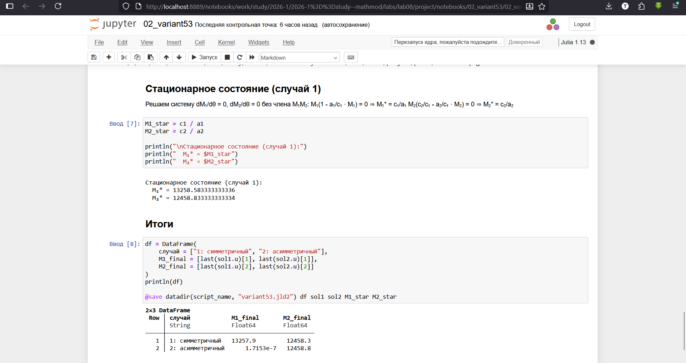

---
## Author
author:
  - name: Бахарев Дмитрий Александрович
    group: НКНбд-01-23
    email: traap.luuvv@mail.ru
    affiliation:
      - name: Российский университет дружбы народов
        country: Российская Федерация
        postal-code: 117198
        city: Москва
        address: ул. Миклухо-Маклая, д. 6
## Title
title: "Отчёт по лабораторной работе №8"
subtitle: "Модель конкуренции двух фирм"
license: "CC BY"
---

# Цель работы

Исследовать модель конкуренции двух фирм, построить графики изменения
оборотных средств, найти стационарное состояние системы.

# Задание

Между двумя фирмами идёт конкурентная борьба за рынок взаимозаменяемых
товаров. Динамика оборотных средств фирм описывается системой:

$$
\begin{cases}
\dfrac{dM_1}{d\theta} = M_1 - \dfrac{b}{c_1} M_1 M_2 - \dfrac{a_1}{c_1} M_1^2, \\[6pt]
\dfrac{dM_2}{d\theta} = \dfrac{c_2}{c_1} M_2 - \dfrac{b}{c_1} M_1 M_2 - \dfrac{a_2}{c_1} M_2^2.
\end{cases}
$$

Рассмотреть два случая:
1. **Симметричный** — чисто рыночная конкуренция.
2. **Асимметричный** — с социально-психологическим фактором.

## Вариант 53

- $M_0^1 = 7.8$, $M_0^2 = 9.8$;
- $p_{cr} = 48$, $N = 50$, $q = 1$;
- $\tau_1 = 34$, $\tau_2 = 28$;
- $\tilde{p}_1 = 9.8$, $\tilde{p}_2 = 11.8$;
- Случай 2: коэффициент перед $M_1 M_2$ для фирмы 1 увеличен
  на $\delta = 0.00043$.

# Теоретическое введение

## Модель одной фирмы

Фирма производит продукт долговременного пользования. Динамика
оборотных средств:

$$\frac{dM}{dt} = -\frac{M}{\tau} + N q \left(1 - \frac{p}{p_{cr}}\right) p - \kappa.$$

Функция спроса: $Q = q(1 - p/p_{cr})$, где $p_{cr}$ — критическая
стоимость продукта.

## Модель двух фирм

Коэффициенты системы:

$$a_i = \frac{p_{cr}}{\tau_i^2 \tilde{p}_i^2 N q}, \quad b = \frac{p_{cr}}{\tau_1^2 \tilde{p}_1^2 \tau_2^2 \tilde{p}_2^2 N q}, \quad c_i = \frac{p_{cr} - \tilde{p}_i}{\tau_i \tilde{p}_i}.$$

## Стационарное состояние

Положение равновесия (при $b \to 0$):

$$M_1^* = \frac{c_1}{a_1}, \quad M_2^* = \frac{c_2}{a_2}.$$

В симметричном случае обе фирмы выживают. В асимметричном — фирма
с меньшим $c_i / a_i$ разоряется.

# Выполнение лабораторной работы

## Создание рабочего пространства

Ветка `feature/lab08` создана через Gitflow, затем инициализирован
проект DrWatson в каталоге `labs/lab08/project` (рис. @fig-1).

{#fig-1 width=70%}

## Установка пакетов

Пакеты Julia установлены в проект (рис. @fig-2).

{#fig-2 width=70%}

## Настройка окружения

Скопирован `tangle.jl` из lab07. Создан кастомный kernel `julia-lab08`
для Quarto (рис. @fig-3).

{#fig-3 width=70%}

## Код скриптов

Скрипт `01_competition.jl` реализует базовую модель (рис. @fig-8).

{#fig-8 width=70%}

Скрипт `02_variant53.jl` решает задачу для варианта 53 (рис. @fig-9).

{#fig-9 width=70%}

## Запуск базового скрипта

Скрипт `01_competition.jl` моделирует конкуренцию двух фирм
(рис. @fig-4).

{#fig-4 width=70%}

| Случай | $M_1$ (финал) | $M_2$ (финал) |
|---|---|---|
| 1: симметричный | 494.9 | 727.9 |
| 2: асимметричный | 0.006 | 728.0 |

В **симметричном** случае обе фирмы выживают и захватывают свои ниши.
В **асимметричном** — первая фирма практически разоряется
($M_1 \to 0$), вторая захватывает рынок.

## Запуск скрипта варианта 53

Скрипт `02_variant53.jl` решает задачу для варианта 53 (рис. @fig-5).

{#fig-5 width=70%}

Коэффициенты варианта 53:

| Параметр | Значение |
|---|---|
| $a_1$ | $8.65 \times 10^{-6}$ |
| $a_2$ | $8.79 \times 10^{-6}$ |
| $b$ | $7.92 \times 10^{-11}$ |
| $c_1$ | 0.1146 |
| $c_2$ | 0.1096 |

Стационарное состояние (случай 1): $M_1^* \approx 13259$, $M_2^* \approx 12459$.

| Случай | $M_1^{final}$ | $M_2^{final}$ |
|---|---|---|
| 1: симметричный | 13257.9 | 12458.3 |
| 2: асимметричный | $\sim 0$ | 12458.8 |

**Ключевой вывод:** в случае 1 обе фирмы выживают. В случае 2
(с асимметричным коэффициентом перед $M_1M_2$) первая фирма
**разоряется**, вторая — продолжает работу.

## Результаты: базовая модель

Графики изменения оборотных средств для базовой модели приведены
на рис. @fig-6.

{#fig-6 width=70%}

## Результаты: вариант 53

Графики для варианта 53 показаны на рис. @fig-7.

{#fig-7 width=70%}

## Jupyter-ноутбуки

Jupyter-ноутбук `01_competition.ipynb` выполнен (рис. @fig-10).

{#fig-10 width=70%}

Jupyter-ноутбук `02_variant53.ipynb` выполнен (рис. @fig-11).

{#fig-11 width=70%}

## Листинги из Julia





# Заключение

В ходе лабораторной работы №8:

- Изучена модель конкуренции двух фирм.
- Реализованы численные решения в Julia с использованием DrWatson.
- Найдены стационарные состояния системы.
- Рассмотрены симметричный и асимметричный случаи.
- Отчёт собран в PDF и DOCX, презентация — в PDF/HTML/Markdown.

# Список литературы {.unnumbered}

::: {#refs}
:::
